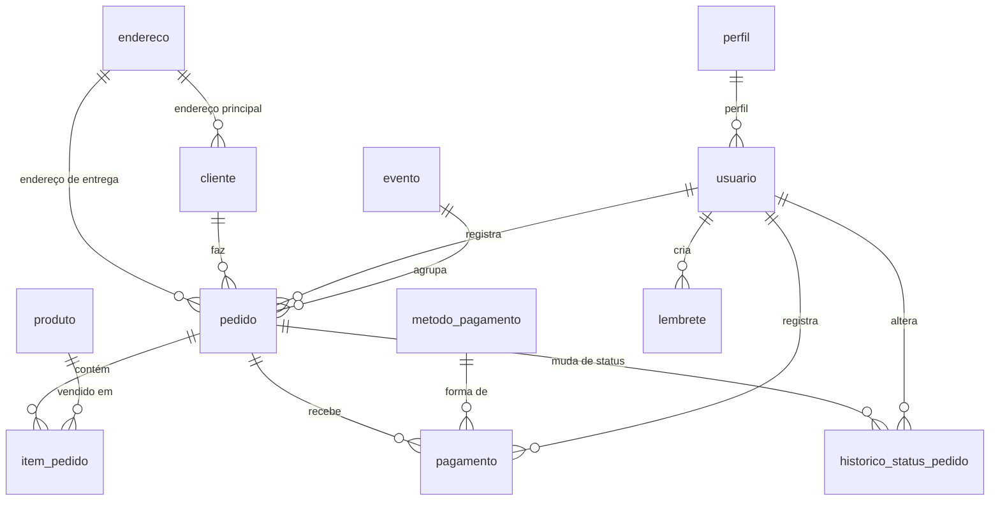

# Dicionário de dados do Tem Na Festa

Fonte única e versionada do dicionário de dados (spec 10, seção 10; DA6). Cobre as duas bases de tendências, o banco MySQL do sistema e as tabelas do Athena. O formato segue a "Especificação de Base de Dados" da disciplina (EBD 3.0, seção 3.1), estendido a todos os campos: **campo, tipo, tamanho, obrigatório, domínio e regra de validação, exemplo real**, mais **descrição, chave e sensibilidade**.

O `make dict` (`scripts/check-dictionary.sh`, na branch `develop`) confere este arquivo com o script do banco na tag `db_schema_ref`, com as colunas das tabelas do Glue (`analytics/tabelas.json`) e com os oito campos com papel da EBD, e recusa tabela ou coluna faltando, sobrando ou com tipo diferente (D12). Por isso as tabelas abaixo seguem um formato fixo: o título de cada uma traz o nome entre crases e a primeira coluna traz o nome do campo entre crases.

**Sensibilidade:** *pessoal* é dado pessoal pela LGPD (nome, contato, endereço, email); *segredo* nunca aparece em exemplo nem sai do banco; *interna* é dado do negócio sem identificação de pessoa; *pública* vem de fonte pública (POF/IBGE, Google Trends).

## 1. Base da EBD: consumo POF/IBGE e popularidade no Google Trends

Coleta semanal da Lambda `tnf-coleta-pof-trends` (10, seção 4). Uma linha por categoria de confeitaria da POF (10 categorias), carga full a cada execução. Layout no bronze em 10, seção 5.

### `pof_trends.bruto`

O arquivo do contrato da EBD, seção 2.1: `produtos_confeitaria_popularidade_mensal.csv`, UTF-8 com BOM, separador `;`, fim de linha `\r\n`, cabeçalho, cinco campos iniciais, uma coluna por mês (dinâmicas, em ordem cronológica) e as métricas. A coluna "Papel na EBD" marca os oito campos da seção 3.1 da EBD, conferidos pelo `make dict`.

| Campo | Papel na EBD | Tipo | Tamanho | Obrigatório | Domínio e regra de validação | Exemplo real | Descrição | Chave | Sensibilidade |
|---|---|---|---|---|---|---|---|---|---|
| `produto_id` | 1. Chave primária | inteiro | 2 | sim | Número estável, único, positivo e não nulo (1 a 10) | 1 | Identificador fixo da categoria (mapa do script) | PK | pública |
| `produto_ibge` | 5. Texto livre a canonicalizar | texto | 100 | sim | Nome da categoria na POF/IBGE, sem espaços nas pontas | Bolos | Categoria da POF, aba `Tabela 3.3 Sudeste`; regra de mapeamento: sem termo no mapa, a coleta é interrompida (EBD 3.4 e 4.2) | | pública |
| `termo_trends` | 6. Chave de cruzamento | texto | 100 | sim | Termo do mapa de busca que liga a categoria à série do Trends | barra de chocolate | Termo pesquisado no Google Trends (`geo=BR-SP`, 12 meses); cruzamento da EBD 3.3 | | pública |
| `consumo_kg_sp` | 7. Livre escolha | decimal | 8,3 | sim | Aquisição domiciliar per capita anual em kg, numérica, não nula e maior que zero | 0.379 | Coluna `São Paulo` da POF; regras de integridade e domínio (EBD 4.2) | | pública |
| `data_coleta` | 2. Campo de data | data | 10 | sim | Data da execução semanal, `YYYY-MM-DD`, fuso de São Paulo | 2026-08-20 | Dia da coleta; vira a partição `data_coleta` no bronze | | interna |
| `AAAA-MM` (12 colunas) | | decimal | 5,2 | sim | 0 a 100; nomes `YYYY-MM` sem repetição e em ordem (regra temporal) | 63.5 | Popularidade média do termo no mês (o mês corrente é parcial) | | pública |
| `popularidade_media` | | decimal | 5,2 | sim | Maior que zero (regra de negócio: média zero é rejeitada) | 48.12 | Média das colunas mensais | | pública |
| `popularidade_pico` | | decimal | 5,2 | sim | 0 a 100 | 100.0 | Maior valor das colunas mensais | | pública |
| `mes_pico` | 8. Livre escolha | inteiro | 2 | sim | Inteiro de 1 a 12, mês da coluna com a maior popularidade | 3 | Mês do pico | | pública |
| `fator_sazonalidade` | 4. Numérico a discretizar | decimal | 5,2 | sim | Maior que zero; `popularidade_pico` ÷ `popularidade_media`, só com média maior que zero | 2.75 | Discretizado em tercis na visão `vw_pof_trends_sazonalidade` (EBD 3.2) | | pública |
| `tipo_feriado_pico` | | texto | 30 | sim | Sempre `Sazonalidade Comercial` | Sazonalidade Comercial | Tipo do evento do pico | | pública |
| `evento_associado` | 3. Categórico de domínio fechado | texto | 60 | sim | Um dos 12 eventos do calendário comercial (abaixo), definido pelo `mes_pico` | Páscoa / Outono | Evento comercial do mês do pico | | pública |

Calendário comercial (`evento_associado` por `mes_pico`): 1 Verão / Férias Escolares; 2 Carnaval; 3 Preparação / Antecedência da Páscoa; 4 Páscoa / Outono; 5 Dia das Mães; 6 Dia dos Namorados / Festas Juninas; 7 Férias de Inverno; 8 Dia dos Pais; 9 Início da Primavera; 10 Dia das Crianças / Halloween; 11 Antecedência de Natal / Black Friday; 12 Festas de Fim de Ano / Natal.

**Discretização (EBD 3.2):** a visão `vw_pof_trends_sazonalidade` divide o `fator_sazonalidade` da coleta atual em tercis (`approx_percentile` 0,33 e 0,66): "Baixa sazonalidade", "Sazonalidade moderada" e "Alta sazonalidade", recalculados a cada coleta.

## 2. Tabelas do Athena (banco `tnf_bronze`)

Tabelas declaradas no Glue sobre o bronze, com *partition projection* (10, seção 6.1). As colunas de partição (`data_coleta`, `env`, `year`, `month`, `day`) vêm do caminho e não se repetem no schema. Os tipos são os do Glue/Athena.

### `tnf_bronze.pof_trends_resumo`

Uma linha por categoria e coleta; partição `data_coleta`. Mesmos campos fixos do `pof_trends.bruto`, sem as colunas mensais.

| Campo | Tipo | Tamanho | Obrigatório | Domínio e regra de validação | Exemplo real | Descrição | Chave | Sensibilidade |
|---|---|---|---|---|---|---|---|---|
| `produto_id` | int | 2 | sim | 1 a 10, único por coleta | 1 | Categoria da POF | PK (com `data_coleta`) | pública |
| `produto_ibge` | string | 100 | sim | Categoria da POF | Bolos | Ver `pof_trends.bruto` | | pública |
| `termo_trends` | string | 100 | sim | Termo do mapa de busca | bolo | Ver `pof_trends.bruto` | | pública |
| `consumo_kg_sp` | double | 8,3 | sim | Maior que zero | 0.379 | kg per capita por ano em SP | | pública |
| `popularidade_media` | double | 5,2 | sim | Maior que zero | 48.12 | Média mensal | | pública |
| `popularidade_pico` | double | 5,2 | sim | 0 a 100 | 100.0 | Pico mensal | | pública |
| `mes_pico` | int | 2 | sim | 1 a 12 | 3 | Mês do pico | | pública |
| `fator_sazonalidade` | double | 5,2 | sim | Maior que zero | 2.75 | Pico ÷ média | | pública |
| `tipo_feriado_pico` | string | 30 | sim | `Sazonalidade Comercial` | Sazonalidade Comercial | Tipo do evento | | pública |
| `evento_associado` | string | 60 | sim | Calendário comercial da seção 1 | Páscoa / Outono | Evento do mês do pico | | pública |

### `tnf_bronze.pof_trends_serie`

Formato longo do `pof_trends.bruto`: uma linha por categoria e mês de referência; partição `data_coleta`.

| Campo | Tipo | Tamanho | Obrigatório | Domínio e regra de validação | Exemplo real | Descrição | Chave | Sensibilidade |
|---|---|---|---|---|---|---|---|---|
| `produto_id` | int | 2 | sim | 1 a 10 | 1 | Categoria da POF | PK (com `mes_referencia` e `data_coleta`) | pública |
| `mes_referencia` | string | 7 | sim | `YYYY-MM`, 12 meses por coleta | 2026-03 | Mês da popularidade | PK | pública |
| `popularidade` | double | 5,2 | sim | 0 a 100 | 63.5 | Popularidade média do mês | | pública |
| `mes_parcial` | boolean | 1 | sim | `true` só no mês corrente | false | Mês ainda incompleto na coleta | | interna |

### `tnf_bronze.pof_trends_rejeicoes`

Arquivo de rejeições da EBD, seção 4.1; partição `data_coleta`. Gravado mesmo quando a coleta é interrompida.

| Campo | Tipo | Tamanho | Obrigatório | Domínio e regra de validação | Exemplo real | Descrição | Chave | Sensibilidade |
|---|---|---|---|---|---|---|---|---|
| `produto_id` | int | 2 | não | 1 a 10, vazio em falha geral | 8 | Categoria afetada | | pública |
| `produto` | string | 100 | não | Categoria ou nome do produto | Sorvete | Produto afetado | | pública |
| `regra` | string | 30 | sim | estrutural, identificação, domínio, integridade, temporal, mapeamento, negócio ou coleta externa (EBD 4.2) | coleta externa | Camada da regra que falhou | | interna |
| `motivo` | string | 300 | sim | Texto livre, sem segredos | sem dados do Google Trends depois de 3 tentativas | O que aconteceu | | interna |
| `severidade` | string | 10 | sim | `bloqueante` ou `aviso` | bloqueante | Se interrompeu a coleta | | interna |
| `data_ocorrencia` | string | 25 | sim | ISO 8601 com fuso de São Paulo | 2026-11-02T09:01:13-03:00 | Quando a regra falhou | | interna |

### `tnf_bronze.tendencias_produtos_resumo`

Produtos ativos do sistema por coleta; partições `env` e `data_coleta`. Produtos sem dados no Trends ficam nas rejeições como aviso e aparecem como "Sem dados suficientes" na visão `vw_tendencias_produtos_atual`.

| Campo | Tipo | Tamanho | Obrigatório | Domínio e regra de validação | Exemplo real | Descrição | Chave | Sensibilidade |
|---|---|---|---|---|---|---|---|---|
| `produto_id` | int | 10 | sim | `produto.id` do banco, único por coleta | 12 | Produto do sistema | PK (com `env` e `data_coleta`); FK → `tem_na_festa.produto.id` | interna |
| `produto_nome` | string | 100 | sim | `produto.nome`, sem espaços nas pontas | Bolo de pote | Termo pesquisado no Trends | | interna |
| `preco_venda` | double | 10,2 | não | Maior ou igual a zero | 12.5 | Preço cadastrado | | interna |
| `popularidade_media` | double | 5,2 | sim | Maior ou igual a zero | 31.4 | Média mensal | | pública |
| `popularidade_pico` | double | 5,2 | sim | 0 a 100 | 100.0 | Pico mensal | | pública |
| `mes_pico` | int | 2 | não | 1 a 12 | 12 | Mês do pico | | pública |
| `fator_sazonalidade` | double | 5,2 | não | Maior que zero; vazio com média zero | 3.18 | Pico ÷ média | | pública |
| `tipo_feriado_pico` | string | 30 | sim | `Sazonalidade Comercial` | Sazonalidade Comercial | Tipo do evento | | pública |
| `evento_associado` | string | 60 | não | Calendário comercial da seção 1 | Festas de Fim de Ano / Natal | Evento do mês do pico | | pública |

### `tnf_bronze.tendencias_produtos_serie`

Formato longo da base dos produtos; partições `env` e `data_coleta`.

| Campo | Tipo | Tamanho | Obrigatório | Domínio e regra de validação | Exemplo real | Descrição | Chave | Sensibilidade |
|---|---|---|---|---|---|---|---|---|
| `produto_id` | int | 10 | sim | `produto.id` do banco | 12 | Produto do sistema | PK (com `mes_referencia`, `env` e `data_coleta`) | interna |
| `mes_referencia` | string | 7 | sim | `YYYY-MM`, os últimos 12 meses | 2026-10 | Mês da popularidade | PK | pública |
| `popularidade` | double | 5,2 | não | 0 a 100; vazio sem dado no mês | 44.0 | Popularidade média do mês | | pública |
| `mes_parcial` | boolean | 1 | sim | `true` só no mês corrente | true | Mês ainda incompleto na coleta | | interna |

### `tnf_bronze.tendencias_produtos_rejeicoes`

Rejeições e avisos da base dos produtos; partições `env` e `data_coleta`. Mesmo formato de `tnf_bronze.pof_trends_rejeicoes`.

| Campo | Tipo | Tamanho | Obrigatório | Domínio e regra de validação | Exemplo real | Descrição | Chave | Sensibilidade |
|---|---|---|---|---|---|---|---|---|
| `produto_id` | int | 10 | não | `produto.id`, vazio em falha geral | 7 | Produto afetado | | interna |
| `produto` | string | 100 | não | Nome do produto | Brigadeiro | Produto afetado | | interna |
| `regra` | string | 30 | sim | Camadas da EBD 4.2 | coleta externa | Regra que falhou | | interna |
| `motivo` | string | 300 | sim | Texto livre, sem email, senha nem cookie | Sem dados suficientes no Google Trends nos últimos 12 meses | O que aconteceu | | interna |
| `severidade` | string | 10 | sim | `bloqueante` ou `aviso` | aviso | Se interrompeu a coleta | | interna |
| `data_ocorrencia` | string | 25 | sim | ISO 8601 com fuso de São Paulo | 2026-11-02T10:15:40-03:00 | Quando a regra falhou | | interna |

### `tnf_bronze.logs_docker`

Saída dos containers dos nós web e app, gravada pelo Fluent Bit (02, seção 7.1; 05, B4); partições `env`, `year`, `month` e `day` (UTC).

| Campo | Tipo | Tamanho | Obrigatório | Domínio e regra de validação | Exemplo real | Descrição | Chave | Sensibilidade |
|---|---|---|---|---|---|---|---|---|
| `date` | string | 30 | sim | ISO 8601 em UTC | 2026-11-02T12:00:01.512Z | Hora do registro (use `"date"` entre aspas no Athena) | | interna |
| `log` | string | livre | sim | Linha do container | GET / HTTP/1.1 200 | Mensagem | | pessoal (pode conter dados do sistema) |
| `stream` | string | 6 | sim | `stdout` ou `stderr` | stdout | Saída do container | | interna |
| `attrs` | map<string,string> | livre | não | Rótulos do Swarm (`com.docker.swarm.service.name`, `com.docker.stack.namespace`) | {"com.docker.swarm.service.name":"tnf-web_frontend"} | Serviço e stack | | interna |
| `host` | string | 63 | sim | Hostname do nó | tem-na-festa-dev-web-1 | Nó de origem | | interna |
| `role` | string | 7 | sim | `web` ou `app` | web | Papel do nó | | interna |
| `log_file` | string | 255 | sim | Caminho do arquivo de log do container | /var/lib/docker/containers/ab12/ab12-json.log | Arquivo lido | | interna |

### `tnf_bronze.logs_auth`

`auth.log` de todas as instâncias, inclusive o bastion (05, B4).

| Campo | Tipo | Tamanho | Obrigatório | Domínio e regra de validação | Exemplo real | Descrição | Chave | Sensibilidade |
|---|---|---|---|---|---|---|---|---|
| `date` | string | 30 | sim | ISO 8601 em UTC | 2026-11-02T12:03:44.000Z | Hora do registro | | interna |
| `ident` | string | 30 | não | Programa que registrou | sshd | Origem da linha | | interna |
| `pid` | string | 10 | não | Número do processo | 1432 | Processo | | interna |
| `message` | string | livre | sim | Linha do auth.log | Accepted publickey for ubuntu from 10.0.0.10 | Mensagem | | pessoal (IP de acesso) |
| `host` | string | 63 | sim | Hostname do nó | tem-na-festa-dev-bastion | Nó de origem | | interna |
| `role` | string | 7 | sim | `web`, `app` ou `bastion` | bastion | Papel do nó | | interna |

### `tnf_bronze.logs_systemd`

Unidades do systemd da lista de 02, seção 7.1 (docker, ssh, fluent-bit, cloud-init, tnf-converge).

| Campo | Tipo | Tamanho | Obrigatório | Domínio e regra de validação | Exemplo real | Descrição | Chave | Sensibilidade |
|---|---|---|---|---|---|---|---|---|
| `date` | string | 30 | sim | ISO 8601 em UTC | 2026-11-02T12:00:30.000Z | Hora do registro | | interna |
| `message` | string | livre | sim | Mensagem da unidade (`MESSAGE`) | converge: ready | Mensagem | | interna |
| `systemd_unit` | string | 60 | sim | Uma das unidades de 02, seção 7.1 (`_SYSTEMD_UNIT`) | tnf-converge.service | Unidade de origem | | interna |
| `priority` | string | 1 | não | 0 a 7 (syslog) | 6 | Prioridade | | interna |
| `host` | string | 63 | sim | Hostname do nó | tem-na-festa-dev-app-1 | Nó de origem | | interna |
| `role` | string | 7 | sim | `web`, `app` ou `bastion` | app | Papel do nó | | interna |

## 3. Banco MySQL `tem_na_festa`

Tabelas do script `script-bd-tem-na-festa.sql` do repositório `TEM-NA-FESTA-database`, na tag `db_schema_ref` (05, B5). É a "base interna" que a EBD, seção 5, prevê cruzar no futuro com o Trends. O tipo é o do script.

### `tem_na_festa.endereco`

| Campo | Tipo | Tamanho | Obrigatório | Domínio e regra de validação | Exemplo real | Descrição | Chave | Sensibilidade |
|---|---|---|---|---|---|---|---|---|
| `id` | BIGINT | 19 | sim | Gerado pelo banco | 3 | Identificador | PK | interna |
| `cep` | VARCHAR(8) | 8 | sim | 8 dígitos, sem traço | 01310100 | CEP | | pessoal |
| `logradouro` | VARCHAR(150) | 150 | sim | Texto | Avenida Paulista | Rua ou avenida | | pessoal |
| `numero` | VARCHAR(10) | 10 | sim | Texto (aceita "s/n") | 1578 | Número | | pessoal |
| `complemento` | VARCHAR(100) | 100 | não | Texto | Apto 12 | Complemento | | pessoal |
| `bairro` | VARCHAR(100) | 100 | sim | Texto | Bela Vista | Bairro | | pessoal |
| `cidade` | VARCHAR(100) | 100 | sim | Texto | São Paulo | Cidade | | pessoal |
| `estado` | CHAR(2) | 2 | sim | Sigla da UF | SP | Estado | | pessoal |

### `tem_na_festa.cliente`

| Campo | Tipo | Tamanho | Obrigatório | Domínio e regra de validação | Exemplo real | Descrição | Chave | Sensibilidade |
|---|---|---|---|---|---|---|---|---|
| `id` | BIGINT | 19 | sim | Gerado pelo banco | 14 | Identificador | PK | interna |
| `nome` | VARCHAR(100) | 100 | sim | Texto | Maria Souza | Nome do cliente | | pessoal |
| `telefone` | VARCHAR(20) | 20 | não | Com DDI e DDD | +55 11 98765-4321 | Telefone | | pessoal |
| `whatsapp` | VARCHAR(20) | 20 | não | Com DDI e DDD; destino das notificações | +55 11 98765-4321 | WhatsApp | | pessoal |
| `instagram` | VARCHAR(50) | 50 | não | Usuário, com ou sem @ | @mariasouza | Instagram | | pessoal |
| `data_cadastro` | DATE | 10 | sim | `YYYY-MM-DD` | 2026-09-15 | Data do cadastro | | interna |
| `anotacoes` | TEXT | 65535 | não | Texto livre | Prefere retirar à tarde | Observações internas | | pessoal |
| `endereco_id` | BIGINT | 19 | não | Endereço existente | 3 | Endereço principal | FK → endereco.id | interna |
| `is_ativo` | BOOLEAN | 1 | sim | Padrão verdadeiro | 1 | Cliente ativo | | interna |
| `is_deletado` | BOOLEAN | 1 | sim | Padrão falso (exclusão lógica) | 0 | Excluído | | interna |

### `tem_na_festa.perfil`

| Campo | Tipo | Tamanho | Obrigatório | Domínio e regra de validação | Exemplo real | Descrição | Chave | Sensibilidade |
|---|---|---|---|---|---|---|---|---|
| `id` | BIGINT | 19 | sim | Gerado pelo banco | 1 | Identificador | PK | interna |
| `nome` | VARCHAR(50) | 50 | sim | `ADMIN` dá o papel `ROLE_ADMIN` no backend | ADMIN | Nome do perfil | | interna |
| `descricao` | TEXT | 65535 | não | Texto | Administrador | Descrição | | interna |

### `tem_na_festa.usuario`

| Campo | Tipo | Tamanho | Obrigatório | Domínio e regra de validação | Exemplo real | Descrição | Chave | Sensibilidade |
|---|---|---|---|---|---|---|---|---|
| `id` | BIGINT | 19 | sim | Gerado pelo banco | 2 | Identificador | PK | interna |
| `nome` | VARCHAR(100) | 100 | sim | Texto | Ana Lima | Nome do usuário | | pessoal |
| `email` | VARCHAR(100) | 100 | sim | Único, em minúsculas | ana@temnafesta.com.br | Login | | pessoal |
| `senha` | VARCHAR(255) | 255 | sim | Hash BCrypt (`$2a$`), senha de 8 a 72 caracteres | *(nunca exibido)* | Hash da senha | | segredo |
| `is_ativo` | BOOLEAN | 1 | sim | Padrão verdadeiro | 1 | Usuário ativo | | interna |
| `is_deletado` | BOOLEAN | 1 | sim | Padrão falso | 0 | Excluído | | interna |
| `data_criacao` | DATETIME | 19 | sim | `YYYY-MM-DD HH:MM:SS`, horário de São Paulo | 2026-10-20 14:02:11 | Criação | | interna |
| `perfil_id` | BIGINT | 19 | sim | Perfil existente | 1 | Perfil | FK → perfil.id | interna |

### `tem_na_festa.evento`

| Campo | Tipo | Tamanho | Obrigatório | Domínio e regra de validação | Exemplo real | Descrição | Chave | Sensibilidade |
|---|---|---|---|---|---|---|---|---|
| `id` | BIGINT | 19 | sim | Gerado pelo banco | 4 | Identificador | PK | interna |
| `nome` | VARCHAR(100) | 100 | sim | Texto | Páscoa 2027 | Nome do evento | | interna |
| `data_inicio` | DATE | 10 | sim | `YYYY-MM-DD`, até `data_fim` | 2027-03-15 | Início | | interna |
| `data_fim` | DATE | 10 | sim | `YYYY-MM-DD` | 2027-03-28 | Fim | | interna |
| `is_ativo` | BOOLEAN | 1 | sim | Padrão verdadeiro | 1 | Evento ativo | | interna |
| `is_deletado` | BOOLEAN | 1 | sim | Padrão falso | 0 | Excluído | | interna |

### `tem_na_festa.pedido`

| Campo | Tipo | Tamanho | Obrigatório | Domínio e regra de validação | Exemplo real | Descrição | Chave | Sensibilidade |
|---|---|---|---|---|---|---|---|---|
| `id` | BIGINT | 19 | sim | Gerado pelo banco | 120 | Identificador | PK | interna |
| `data_pedido` | DATETIME | 19 | sim | Horário de São Paulo | 2026-10-28 10:15:00 | Quando foi feito | | interna |
| `data_entrega` | DATETIME | 19 | sim | Igual ou depois de `data_pedido` | 2026-11-01 16:00:00 | Entrega ou retirada | | interna |
| `valor_total` | DECIMAL(10,2) | 10,2 | sim | Maior ou igual a zero | 245.00 | Valor do pedido | | interna |
| `taxa_entrega` | DECIMAL(10,2) | 10,2 | não | Padrão 0.00 | 15.00 | Taxa de entrega | | interna |
| `observacao` | TEXT | 65535 | não | Texto livre | Escrever "Parabéns, Lia" | Observação | | pessoal |
| `status_producao` | VARCHAR(50) | 50 | sim | RASCUNHO, AGUARDANDO_SINAL, CONFIRMADO, EM_PRODUCAO, PRONTO_PARA_ENTREGA, ENTREGUE ou CANCELADO (`StatusProducaoEnum` do backend; o banco guarda texto livre) | CONFIRMADO | Situação da produção | | interna |
| `cliente_id` | BIGINT | 19 | sim | Cliente existente | 14 | Cliente | FK → cliente.id | interna |
| `usuario_id` | BIGINT | 19 | sim | Usuário existente | 2 | Quem registrou | FK → usuario.id | interna |
| `evento_id` | BIGINT | 19 | não | Evento existente | 4 | Evento do pedido | FK → evento.id | interna |
| `endereco_entrega_id` | BIGINT | 19 | não | Vazio = retirada no local | 3 | Endereço de entrega | FK → endereco.id | interna |
| `is_ativo` | BOOLEAN | 1 | sim | Padrão verdadeiro | 1 | Pedido ativo | | interna |
| `is_deletado` | BOOLEAN | 1 | sim | Padrão falso | 0 | Excluído | | interna |

### `tem_na_festa.metodo_pagamento`

| Campo | Tipo | Tamanho | Obrigatório | Domínio e regra de validação | Exemplo real | Descrição | Chave | Sensibilidade |
|---|---|---|---|---|---|---|---|---|
| `id` | BIGINT | 19 | sim | Gerado pelo banco | 1 | Identificador | PK | interna |
| `nome` | VARCHAR(50) | 50 | sim | Texto | PIX | Forma de pagamento | | interna |

### `tem_na_festa.pagamento`

| Campo | Tipo | Tamanho | Obrigatório | Domínio e regra de validação | Exemplo real | Descrição | Chave | Sensibilidade |
|---|---|---|---|---|---|---|---|---|
| `id` | BIGINT | 19 | sim | Gerado pelo banco | 88 | Identificador | PK | interna |
| `valor` | DECIMAL(10,2) | 10,2 | sim | Maior que zero | 122.50 | Valor pago | | interna |
| `data_pagamento` | DATETIME | 19 | sim | Horário de São Paulo | 2026-10-28 10:20:00 | Quando foi pago | | interna |
| `tipo_pagamento` | VARCHAR(30) | 30 | sim | SINAL, QUITACAO ou INTEGRAL (`TipoPagamentoEnum` do backend; o padrão do script, `BIGINTEGRAL`, é um erro de digitação) | SINAL | Tipo do pagamento | | interna |
| `status_pagamento` | VARCHAR(30) | 30 | sim | PENDENTE, CONFIRMADO ou CANCELADO (`StatusPagamentoEnum`; padrão CONFIRMADO) | CONFIRMADO | Situação do pagamento | | interna |
| `metodo_pagamento_id` | BIGINT | 19 | sim | Método existente | 1 | Forma de pagamento | FK → metodo_pagamento.id | interna |
| `pedido_id` | BIGINT | 19 | sim | Pedido existente | 120 | Pedido | FK → pedido.id | interna |
| `usuario_id` | BIGINT | 19 | sim | Usuário existente | 2 | Quem registrou | FK → usuario.id | interna |

### `tem_na_festa.historico_status_pedido`

| Campo | Tipo | Tamanho | Obrigatório | Domínio e regra de validação | Exemplo real | Descrição | Chave | Sensibilidade |
|---|---|---|---|---|---|---|---|---|
| `id` | BIGINT | 19 | sim | Gerado pelo banco | 301 | Identificador | PK | interna |
| `data_alteracao` | DATETIME | 19 | sim | Horário de São Paulo | 2026-10-29 08:00:00 | Quando mudou | | interna |
| `observacao` | TEXT | 65535 | não | Texto livre | Sinal recebido | Observação | | interna |
| `status_producao` | VARCHAR(50) | 50 | sim | Os mesmos valores de `pedido.status_producao`; padrão RASCUNHO | EM_PRODUCAO | Novo status | | interna |
| `pedido_id` | BIGINT | 19 | sim | Pedido existente | 120 | Pedido | FK → pedido.id | interna |
| `usuario_id` | BIGINT | 19 | sim | Usuário existente | 2 | Quem alterou | FK → usuario.id | interna |

### `tem_na_festa.produto`

| Campo | Tipo | Tamanho | Obrigatório | Domínio e regra de validação | Exemplo real | Descrição | Chave | Sensibilidade |
|---|---|---|---|---|---|---|---|---|
| `id` | BIGINT | 19 | sim | Gerado pelo banco | 12 | Identificador; é o `produto_id` da base dos produtos | PK | interna |
| `nome` | VARCHAR(100) | 100 | sim | Texto; termo pesquisado no Trends | Bolo de pote | Nome do produto | | interna |
| `descricao` | TEXT | 65535 | não | Texto livre | Bolo de chocolate com brigadeiro | Descrição | | interna |
| `preco_venda` | DECIMAL(10,2) | 10,2 | sim | Maior ou igual a zero | 12.50 | Preço | | interna |
| `is_ativo` | BOOLEAN | 1 | não | Padrão verdadeiro; só ativos vão para a coleta | 1 | Produto ativo | | interna |
| `is_deletado` | BOOLEAN | 1 | sim | Padrão falso | 0 | Excluído | | interna |

### `tem_na_festa.item_pedido`

| Campo | Tipo | Tamanho | Obrigatório | Domínio e regra de validação | Exemplo real | Descrição | Chave | Sensibilidade |
|---|---|---|---|---|---|---|---|---|
| `id` | BIGINT | 19 | sim | Gerado pelo banco | 540 | Identificador | PK | interna |
| `pedido_id` | BIGINT | 19 | sim | Pedido existente | 120 | Pedido | FK → pedido.id | interna |
| `produto_id` | BIGINT | 19 | sim | Produto existente e ativo na criação | 12 | Produto | FK → produto.id | interna |
| `quantidade` | BIGINT | 19 | sim | Maior que zero | 20 | Quantidade | | interna |
| `preco_unitario` | DECIMAL(10,2) | 10,2 | sim | Maior ou igual a zero | 12.50 | Preço na hora do pedido | | interna |
| `observacao_item` | TEXT | 65535 | não | Texto livre | Sem lactose | Observação do item | | interna |

### `tem_na_festa.lembrete`

| Campo | Tipo | Tamanho | Obrigatório | Domínio e regra de validação | Exemplo real | Descrição | Chave | Sensibilidade |
|---|---|---|---|---|---|---|---|---|
| `id` | BIGINT | 19 | sim | Gerado pelo banco | 9 | Identificador | PK | interna |
| `descricao` | TEXT | 65535 | sim | Texto livre | Comprar formas de cupcake | Lembrete | | interna |
| `data_criacao` | DATE | 10 | sim | `YYYY-MM-DD` | 2026-10-28 | Criação | | interna |
| `data_limite` | DATE | 10 | sim | Igual ou depois de `data_criacao` | 2026-11-05 | Prazo | | interna |
| `usuario_id` | BIGINT | 19 | sim | Usuário existente | 2 | Dono do lembrete | FK → usuario.id | interna |

**Colunas criadas pelo backend fora do script.** O backend roda com `ddl-auto=update` (05, A4) e acrescenta colunas que o script da tag não tem: `pedido.desconto_pedido` e `pedido.versao`, `item_pedido.acrescimo`, `pagamento.chave_idempotencia` e `pagamento.assinatura_requisicao`. Elas não entram na conferência automática, que segue o script; quando o script do `TEM-NA-FESTA-database` as incorporar numa tag nova, entram aqui junto com a mudança do `db_schema_ref`.
