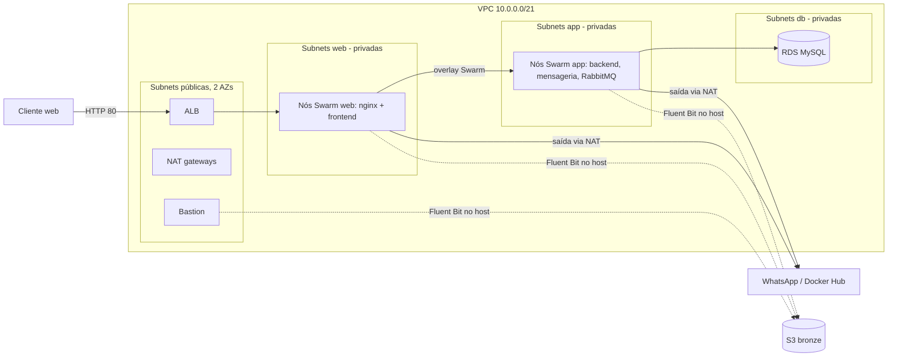
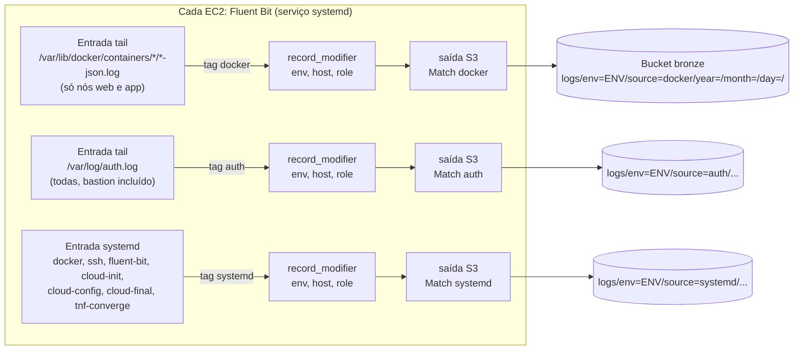

# 02 – Arquitetura

Estado: **fechado** (aprovado em 09/10/2026; testes no laboratório executados em 09/10/2026, só o limite de Elastic IPs e a contagem do RDS ficam para a implementação, 09, E3 e E4b). Consolidado com as decisões de 05 a 09. Ajustado em 10/10/2026: acesso manual ao banco pelos nós app (seções 6 e 8, A12; auditoria item 5); configuração concreta do Fluent Bit, lista de unidades do systemd e anexo A (seção 7.1, A13; auditoria item 9); metadados da instância protegidos, IMDSv2 obrigatório e limite de saltos 1 (seção 4, A14; auditoria item 17); rótulo do subgrafo do anexo A com aspas; acesso ao bastion a partir de outras máquinas e redes, `infra access` (seções 5 e 8, A15; auditoria item 18); microsserviço de WhatsApp fixado no `app-1` por rótulo, por causa da sessão (seção 4, A16; auditoria item 19).
Base: diagrama de referência do projeto, com as mudanças registradas em 01 (RDS no lugar das EC2 de banco; EFS fora) e as da seção 3 abaixo.

## 1. Visão geral

## 2. Duas camadas de Terraform (*Decidido*)
| Camada | Conteúdo | Ciclo de vida |
|---|---|---|
| `bootstrap` | bucket do state do Terraform; bucket bronze (e futuros silver/gold) | rodada **uma vez**; nunca entra no destroy dos ambientes |
| `envs/dev` e `envs/prod` | VPC, ALB, EC2, RDS, security groups, bucket de artefatos (compose files e scripts de subida, recriado a cada `apply`), parâmetros SSM de segredos | criada e destruída a cada ciclo; cada ambiente tem o seu state |

- **Por que duas camadas:** o bucket do state precisa existir antes de o Terraform começar a gravar nele (ovo e galinha), e os buckets de dados precisam sobreviver ao destroy (RF-06). Misturá-los à infra efêmera exigiria truques de `prevent_destroy`.
- **State remoto em S3** (*Decidido*): permite migrar depois para o GitHub Actions sem trabalho extra e protege contra perda do arquivo local.
- **Lock por arquivo:** antes de cada `apply`/`destroy`, o Terraform grava um pequeno arquivo de lock ao lado do state no bucket e o remove no fim. Se outra execução tentar começar enquanto o arquivo existe, ela é recusada, o que evita duas execuções corrompendo o mesmo state. Exige Terraform 1.11 ou superior e dispensa a tabela DynamoDB que era necessária antes.
- O nome do bucket (que inclui o ID da conta) é passado na chamada do `init` pelo script de subida, pois o bloco do backend não aceita variáveis.
- O bucket de artefatos pertence ao ambiente, não ao `bootstrap`: seu conteúdo é regerado pelo Terraform a cada `apply`, então não precisa persistir (criado com `force_destroy`).
- Os módulos reutilizáveis ficam em `modules/`; a estrutura do repositório está em 08.

## 3. Região e rede
- Região **definida por variável em cada ambiente** (*Decidido*); padrão `us-east-1`. O laboratório só permite `us-east-1` e `us-west-2` (ver seção 10).
- VPC `10.0.0.0/21` por ambiente (*Decidido*, vem do diagrama). Dev e prod são VPCs separadas, sem peering.

| Subnet | AZ1 | AZ2 | Tipo |
|---|---|---|---|
| pública | 10.0.0.0/24 | 10.0.7.0/24 | pública (ALB, NAT, bastion); **sempre nas 2 AZs** |
| web | 10.0.1.0/24 | 10.0.2.0/24 | privada (nós web; saída via NAT da mesma AZ) |
| app | 10.0.3.0/24 | 10.0.4.0/24 | privada (nós app; saída via NAT da mesma AZ) |
| db | 10.0.5.0/24 | 10.0.6.0/24 | privada (RDS); **sempre nas 2 AZs** |

- **Ajustes ao diagrama (*Decidido*):**
  1. O diagrama dá `10.0.5.0/24` às duas subnets de banco, o que é impossível (CIDRs não podem repetir). A AZ2 passa a `10.0.6.0/24`.
  2. As subnets web passam a ser privadas e o ALB, a NAT e o bastion vão para duas subnets públicas novas (usam os blocos que haviam ficado livres). Motivo na seção 5.
- O ALB exige subnets em pelo menos 2 AZs e o RDS também, então as subnets públicas e as de banco existem nas duas AZs mesmo quando `az_count = 1`. As subnets web e app seguem `az_count`.
- NAT: variável `nat_mode` com `per_az` (uma NAT por AZ ativa, na subnet pública daquela AZ) ou `single` (uma só, na AZ1). Cada NAT consome um Elastic IP (seção 10).
- Os CIDRs das subnets são derivados de `vpc_cidr` (ver 03, seção 5), não digitados.

## 4. Computação e Swarm
- Todas as instâncias são EC2 criadas por `for_each` (nomes e posições determinísticos), em vez de Auto Scaling Group (*Decidido*). Motivo: o Swarm se monta com muito menos complexidade e não há autoscaling no escopo. Evolução futura: ASG de tamanho fixo para autocura.
- **Nenhum nó do Swarm tem IP público** (*Decidido*): todos saem para a internet pela NAT. Só o ALB e o bastion ficam expostos.
- Instâncias usam o **instance profile do laboratório** (`LabInstanceProfile`, associado à LabRole). Assim leem S3 e parâmetros do SSM e o Fluent Bit escreve no S3 sem nenhuma chave em arquivo (RES-03).
- **Metadados da instância protegidos (*Decidido* em 10/10/2026, A14; auditoria item 17).** O serviço de metadados (`169.254.169.254`) entrega as credenciais temporárias da LabRole a quem perguntar de dentro da instância. Para que um container comprometido não consiga pedi-las (e, com elas, ler o SSM, inclusive o `db_admin_password`, 05, A7), **todas as EC2** (web, app e bastion) são criadas com `metadata_options`:
  - `http_tokens = "required"`: só o IMDSv2, que exige pedir antes um token por uma requisição `PUT`; o IMDSv1 (sem token) fica desligado;
  - `http_put_response_hop_limit = 1`: a resposta com o token não atravessa a rede do Docker (a ponte e a rede overlay contam como um salto a mais), então um container não consegue o token;
  - `http_endpoint = "enabled"`: o serviço continua ligado para os processos do host.
  - É regra **fixa do módulo `compute`**, sem variável (08, seção 3); a mudança de `metadata_options` numa instância existente é feita no lugar, sem recriá-la.
  - **O que continua funcionando:** tudo o que roda no host, como AWS CLI v2, Fluent Bit, `cloud-init`, os scripts de `node/` e o `tnf-db-shell`, pede o token normalmente. Nenhum container do projeto precisa de credenciais da AWS: os segredos chegam como segredos Docker, lidos do SSM pelo líder (05, A2 e A3).
  - **Limitações aceitas:** um container com `network_mode: host` ou privilegiado alcançaria o metadado; nenhuma stack faz isso, e quem acrescentar uma deve rever esta regra. Quem tem acesso de administrador ao nó (SSH) tem as credenciais por definição: é o acesso previsto (seção 8).
  - Se um componente não funcionar com o IMDSv1 desligado, corrige-se o componente (por exemplo, atualizando a versão); a regra não é afrouxada sem nova decisão. Verificado por Q22 (05) e pelo plano (09, E4a e E6).
- **Tipos de instância por variável** (*Decidido*): um tipo para `web`, um para `app`, um para o bastion e uma classe para o RDS. Padrões: web `t3.micro`; app `t3.small` (o backend Spring Boot, o RabbitMQ e o Docker disputam memória e 1 GB costuma ser pouco); bastion `t3.micro`; RDS `db.t3.micro` (dev) e `db.t3.small` (prod). As variáveis validam que o tipo está entre `nano` e `large` (limite do laboratório).
- **Grupos de nós:** `web` (subnets web) e `app` (subnets app). A quantidade é um **total por grupo**, distribuído em rodízio entre as AZs ativas (detalhe em 03).
- **Managers (*Decidido*):** os primeiros nós `app`, que também rodam carga. Variável `manager_count` (1, 3 ou 5; padrão dev 1, prod 3), com validação de que não excede o número de nós `app`.
  - Managers são os nós que guardam o estado do cluster e decidem onde cada container roda; workers só rodam containers. O quórum exige a maioria dos managers de pé, por isso o número é ímpar.
  - Com 2 AZs, 3 managers ficam 2+1; se a AZ com 2 managers cair, o cluster perde quórum (os containers continuam rodando, mas não dá para gerenciar o Swarm até a AZ voltar). É uma limitação aceitável no laboratório.
  - Máquinas dedicadas a managers ficam descartadas: custam instâncias extras e o laboratório limita a 9 instâncias EC2 simultâneas por região.
- **Posicionamento** por rótulos de nó (`tier=web`, `tier=app`, e, no primeiro nó app, `rabbitmq=true` e `messaging=true`), aplicados pelo manager líder na subida a partir do nome do host (detalhe em 04).
  - **`messaging=true` (*Decidido* em 10/10/2026, A16; auditoria item 19):** o microsserviço de WhatsApp pode precisar de uma sessão pareada, guardada em disco. Para que o serviço sempre volte ao mesmo nó, onde fica o volume da sessão, ele é fixado no `app-1` por esse rótulo, o mesmo nó do RabbitMQ (mesmo padrão e mesma limitação, P1). O rótulo é aplicado mesmo com a mensageria desligada. O pareamento é um passo manual, uma vez por ambiente novo (06, seção 6.4.1).
- **Cliente MySQL (*Decidido* em 10/10/2026, A12):** todos os nós `app` (e só eles) levam o pacote `mysql-client` do Ubuntu 24.04 (série 8.0, compatível com o RDS 8.0). É o que o `db-init` (executado pelo líder, que é um nó app) e a operação manual usam para falar com o RDS. Nós web e bastion não têm o cliente (04, seção 5).

| Serviço | Onde roda | Observação |
|---|---|---|
| frontend (nginx + React) | nós `web` | publica a porta 80; faz proxy de `/api/` para `backend-som:8080` |
| backend (Spring Boot) | nós `app` | serviço com o nome `backend-som` na rede overlay (nome exigido pelo nginx atual); envia eventos ao microsserviço |
| mensageria (WhatsApp) | **um único nó `app`**, o `app-1` (fixado por rótulo), com volume local se houver sessão | recebe eventos do backend (06, seção 6.5) e usa o RabbitMQ; saída pela NAT; desligada até a E8 (03, seção 3.4); pode exigir pareamento manual (06, seção 6.4.1) |
| RabbitMQ | **um único nó `app`** (fixado por rótulo), com volume local | usado só pelo microsserviço; ver P1 na seção 9 |
| Fluent Bit | **instalado em cada EC2, inclusive no bastion** (serviço systemd), não em container | ver seção 7 |

Detalhe das stacks, da rede overlay e da política de atualização em 06.

## 5. Entrada de tráfego e segurança
- **ALB** público nas subnets públicas das duas AZs, listener HTTP 80 (*Decidido*: sem HTTPS por ora), com target group nos nós `web` na porta publicada pelo frontend.
- O ALB alcança os nós web nas subnets privadas pelo IP interno; o Swarm tem *routing mesh*: qualquer nó que receba a conexão a encaminha ao serviço, então registrar todos os nós `web` no target group basta.
- **Por que nós web privados (*Decidido*):** nenhum nó do Swarm precisa de IP público nem de regra de entrada vinda da internet; a superfície exposta se reduz ao ALB (porta 80) e ao bastion (SSH restrito ao seu IP). O custo é o desvio do diagrama (duas subnets públicas a mais), sem custo financeiro adicional, pois a NAT já existia.
- **Credenciais da instância fora do alcance dos containers:** além das regras de rede abaixo, o acesso às credenciais da LabRole pelo serviço de metadados é restrito ao host (IMDSv2 obrigatório e limite de saltos 1; seção 4, A14).

| Security group | Entradas permitidas |
|---|---|
| `alb` | 80 de `0.0.0.0/0` |
| `swarm-web` | 80 do `alb`; 22 do `bastion`; tráfego do Swarm vindo de `swarm-web` **e** de `swarm-app` |
| `swarm-app` | 22 do `bastion`; tráfego do Swarm vindo de `swarm-app` **e** de `swarm-web` |
| `rds` | 3306 do `swarm-app` (e de mais ninguém: nem do bastion nem do `swarm-web`) |
| `bastion` | 22 de `admin_ssh_cidrs` (seu IP atual, nunca `0.0.0.0/0`; ver o parágrafo abaixo e a seção 8, A15) |

- Tráfego do Swarm: 2377/tcp (managers), 7946/tcp+udp e 4789/udp (rede overlay), liberados **apenas entre membros do Swarm**, o que inclui **web ↔ app** (o frontend, nos nós web, fala com o backend, nos nós app, pela rede overlay; sem essa regra cruzada o `proxy_pass` falha). Verificado pelo teste R3 de 06.
- **Bastion:** uma EC2 na subnet pública da AZ1, só para depuração (RF-02). O CIDR de origem do SSH é a variável `admin_ssh_cidrs` (03, seção 3.6). Como o seu IP muda de rede em rede, o `infra` o detecta a cada `plan`, `up` e `access` (08, seção 5.6), e o IP novo **substitui** o anterior.

## 6. Banco de dados
- **RDS MySQL** em um *DB subnet group* nas subnets db, sem acesso público, acessível só pelo `swarm-app`. `multi_az` controlado por variável (RF-05), **padrão desligado** por decisão do projeto (evitar custo); o console do laboratório oferece a opção, então o usuário pode ligá-la para testar.
- Persistência por **snapshot** a cada destroy e restauração na subida seguinte (RF-06). Detalhe do ciclo em 05.
- O backend recebe `DB_URL` apontando para o endpoint do RDS (config do ambiente, não segredo) e um usuário próprio da aplicação em vez de `root`, com permissões restritas ao schema (05, A4).
- **Quem fala com o RDS por SQL além do backend:** a rotina `db-init` (no líder) e a operação manual, ambas a partir de um **nó app**, com o cliente MySQL de A12. O bastion não chega ao banco (a regra do `rds` só aceita o `swarm-app`).

## 7. Dados e logs
- **Bucket bronze** persistente (camada `bootstrap`), com o nome no padrão que você já usa (`bucket-bronze-<id-da-conta>-us-east-1`). Os logs de dev e prod usam prefixos diferentes (`env=dev/`, `env=prod/`) dentro do mesmo bucket. *Decidido.*
- **Fluent Bit instalado em cada EC2** (*Decidido*): serviço systemd configurado na subida, com as três entradas do seu diagrama: logs de containers Docker, `auth.log` e systemd; saída em JSON para o bucket bronze por S3 output, com a chave por data (layout em 05, B4). Não roda como container do Swarm. A configuração concreta está em 7.1 e o diagrama redesenhado, no anexo A.
- **Inconsistência corrigida (achado na sua imagem):** o `match` da saída era `nginx.logs`, mas as tags das entradas são `docker.apps`, `so.auth` e `systemd.app`, então nada casaria com a saída. A especificação usa uma tag por origem (`docker`, `auth`, `systemd`) e **uma saída para cada tag**, com chaves de S3 separadas por origem.
- **A entrada de systemd do seu diagrama filtrava `app.service`, que não existe neste desenho** (a aplicação roda em containers, cujos logs entram pela origem `docker`). Ela foi substituída por uma lista fechada de unidades (7.1).
- Datalake além do bronze (Lambda, Glue, Athena, silver/gold): fora do escopo.

### 7.1 Configuração do Fluent Bit (*Decidido* em 10/10/2026, A13)
O `node-bootstrap.sh` renderiza a configuração a partir de `node/fluent-bit/fluent-bit.conf.tftpl` e `parsers.conf` (08), com `env`, região, bucket bronze e papel do nó, e habilita o serviço (04, seção 5, passo 3).

**Entradas**
| Origem (`source`) | Tag | Como lê | Conteúdo | Em quais nós |
|---|---|---|---|---|
| `docker` | `docker` | `tail` de `/var/lib/docker/containers/*/*-json.log`, parser `docker`, `Read_from_Head On`, `Skip_Long_Lines On`, `Path_Key log_file` | stdout e stderr dos containers; o campo `attrs` traz `com.docker.swarm.service.name` e `com.docker.stack.namespace` (04, seção 5, passo 2), que dizem de qual serviço vem a linha | web e app |
| `auth` | `auth` | `tail` de `/var/log/auth.log`, parser `syslog-rfc3164`, `Read_from_Head On` | logins SSH, `sudo` e demais eventos de autenticação | **todas**, bastion incluído (é onde os acessos ficam registrados) |
| `systemd` | `systemd` | entrada `systemd`, `Read_From_Tail Off` (lê desde o início do boot, para pegar o `cloud-init`), com um `Systemd_Filter` por unidade da lista abaixo (combinados por "ou") | mensagens do journal **só das unidades da lista** | **todas** |

**Lista de unidades do systemd (*Decidido*):** `docker.service`, `ssh.service`, `fluent-bit.service`, `cloud-init.service`, `cloud-config.service`, `cloud-final.service` e `tnf-converge.service`.
- `cloud-final.service` carrega a saída do `user_data` e do `node-bootstrap.sh`; `tnf-converge.service` carrega a saída da convergência no líder (04, seção 7). Por isso os arquivos `/var/log/tnf-*.log` ficam só locais.
- Unidades que não existem em um nó (por exemplo `docker.service` no bastion) simplesmente não geram nada; a lista é a mesma em todos.
- Nada fora da lista é enviado (rede, timers do sistema, `snap` etc.). Para coletar outra unidade, basta acrescentá-la à constante `fluent_bit_systemd_units` do módulo `compute` e recriar o nó (ou o ambiente).

**Acréscimos a todo registro (filtro `record_modifier`):** `env` (dev ou prod), `host` (hostname do nó) e `role` (`web`, `app` ou `bastion`).

**Saídas (uma por tag, três ao todo)**
| Parâmetro | Valor |
|---|---|
| `Name` | `s3` |
| `Match` | `docker`, `auth` ou `systemd` (cada saída casa com uma só tag) |
| `bucket` / `region` | bucket bronze / região da conta do bronze |
| `s3_key_format` | `/logs/env=<env>/source=<origem>/year=%Y/month=%m/day=%d/<hostname>_%H%M%S_$UUID.json` (as partições são em **UTC**) |
| `total_file_size` / `upload_timeout` | `10M` / `1m` (o que vier primeiro) |
| `store_dir` / `store_dir_limit_size` | `/var/lib/fluent-bit/s3` / `200M` (limita o disco usado pelo buffer) |
| formato | JSON, uma entrada por linha; `json_date_key date`, `json_date_format iso8601` |
| `retry_limit` | `5` |
| credenciais | do instance profile, obtidas pelo IMDSv2 (nada em arquivo; seção 4, A14) |

**Serviço e persistência:** `flush 5`; `storage.path /var/lib/fluent-bit/storage`; cada `tail`/`systemd` guarda o seu `DB` em `/var/lib/fluent-bit/` (para não reenviar linhas depois de um reinício do serviço); `Mem_Buf_Limit 5MB` nas entradas. O diretório `/var/lib/fluent-bit/` é criado pelo `node-bootstrap.sh`.

**Limitações aceitas**
- Rastros de pilha (*stack traces*) do Java chegam como uma linha por registro, em ordem; juntá-las em um evento só (parser multilinha) fica para a fase do datalake.
- Os logs dos últimos ~60 s antes de um `infra down` podem se perder (04, seção 9).
- O Ubuntu 24.04 da AMI padrão traz o `rsyslog`, que grava `/var/log/auth.log`; a presença do arquivo é conferida na E4a (Q17) e, se faltar, o `node-bootstrap.sh` passa a instalar o `rsyslog`.
- O Fluent Bit do repositório oficial lê as credenciais pelo IMDSv2; isso é conferido na E4a, quando os objetos aparecem no bronze (Q17, Q22). Se uma versão não suportar, atualiza-se a versão, sem afrouxar A14.
- O QR code ou código de pareamento do WhatsApp, quando existe, é impresso nos logs do container e, portanto, também chega ao bronze pela origem `docker` (06, seção 6.4.1). É de vida curta e inútil depois do pareamento.

## 8. Acesso administrativo
- SSH só pelo bastion, com o atalho `infra ssh` (08). Sem SSH direto da internet para nós Swarm.
- O par de chaves é gerado pelo Terraform (`aws_key_pair`) e a chave privada é gravada localmente com permissão restrita (*Decidido*). Motivo: o par `vockey` do laboratório só existe na região `us-east-1`. A chave privada também fica no state do Terraform (saída sensível), de onde o `infra access` a recupera em outra máquina (A15).
- **Acesso manual ao banco (*Decidido* em 10/10/2026, A12):** `infra ssh <env> app-1` (ou outro nó app) e, no nó, o comando `tnf-db-shell`, que abre o cliente MySQL no RDS com o usuário administrador sem que a senha apareça na linha de comando (05, A7). Não há túnel do bastion ao RDS nem cliente no bastion ou nos nós web.
- **Pareamento do WhatsApp:** também é feito por `infra ssh <env> app-1`, lendo os logs do serviço `messaging` (06, seção 6.4.1).
- **Acesso a partir de outras máquinas e redes (*Decidido* em 10/10/2026, A15; auditoria item 18).** Você é o operador único, mas trabalha em máquinas e redes diferentes. Duas coisas amarravam o SSH à máquina e à rede do `infra up`: a chave privada em `.keys/<env>.pem` e o IP autorizado no bastion. O comando **`infra access <env>`** resolve as duas, e o `infra ssh` o aciona antes de conectar:
  - **Chave:** se `.keys/<env>.pem` não existir na máquina, é reconstruída a partir do state (permissão `600`, nunca em `/mnt/c`).
  - **IP:** o `infra` detecta o seu IP público atual; se ele não estiver entre os CIDRs autorizados no bastion, mostra a diferença e, **com a sua confirmação**, aplica pelo Terraform só a mudança dessa regra do security group. O IP novo substitui o anterior; se a lista `admin_ssh_cidrs` estiver preenchida no `terraform.tfvars`, ela é sua e o `infra` não a altera (só avisa).
  - **Segurança:** `0.0.0.0/0` continua proibido (T9, 03); o comando nunca altera outro recurso (se o `plan` mostrar qualquer outra mudança, ele recusa e manda rodar `infra up`); nenhum recurso novo na AWS. Detalhes em 08, seção 5.6.
  - **Limitação aceita:** um só IP autorizado por vez. Acessar de dois lugares ao mesmo tempo exige preencher `admin_ssh_cidrs` com os dois no `terraform.tfvars`.

## 9. Decisões e pendências
| # | Tema | Situação |
|---|---|---|
| A1 | Duas camadas de Terraform (`bootstrap` e `envs/*`) | **Decidido** |
| A2 | State remoto em S3 com lock por arquivo | **Decidido** |
| A3 | EC2 por `for_each` em vez de ASG | **Decidido** |
| A4 | Managers como subconjunto dos nós `app` | **Decidido** |
| A5 | Nós web em subnet privada; ALB, NAT e bastion em subnets públicas novas | **Decidido** |
| A6 | Fluent Bit instalado em cada EC2 (systemd), não em container | **Decidido** |
| A7 | Bronze único com prefixo por ambiente | **Decidido** |
| A8 | Subnet db AZ2 = `10.0.6.0/24` | **Decidido** |
| A9 | Bucket de artefatos na camada do ambiente | **Decidido** |
| A10 | Região por variável em cada ambiente (padrão `us-east-1`) | **Decidido** |
| A11 | Tráfego do Swarm liberado entre `swarm-web` e `swarm-app` | **Decidido** (consequência de 06) |
| A12 | Cliente MySQL só nos nós `app`; `db-init` no líder; operação manual por `infra ssh` num nó app + `tnf-db-shell`; bastion e nós web sem cliente nem acesso ao RDS | **Decidido** (10/10/2026) |
| A13 | Fluent Bit: três origens (`docker`, `auth`, `systemd`), uma tag e uma saída S3 por origem; no bastion também; systemd só com a lista fechada de unidades (7.1); `app.service` do desenho original substituído | **Decidido** (10/10/2026, opção A da auditoria item 9) |
| A14 | Metadados das EC2 protegidos: IMDSv2 obrigatório (`http_tokens = "required"`) e limite de saltos 1 em web, app e bastion, regra fixa do módulo `compute`; containers não obtêm as credenciais da LabRole; sem camada extra de firewall; stacks não usam `network_mode: host` | **Decidido** (10/10/2026, opção A da auditoria item 17) |
| A15 | Acesso de outras máquinas e redes: `infra access <env>` reconstrói a chave do state e atualiza o IP autorizado no bastion (com confirmação, só a regra do security group); `infra ssh` o aciona; `admin_ssh_cidrs` preenchido no `tfvars` não é alterado; sem recurso novo na AWS | **Decidido** (10/10/2026, opção A da auditoria item 18) |
| A16 | Microsserviço de WhatsApp fixado no `app-1` pelo rótulo `messaging=true` (aplicado sempre, mesmo com a mensageria desligada), com volume local para a sessão quando houver; pareamento manual declarado como exceção ao nível 4, uma vez por ambiente novo (06, seção 6.4.1; 01, RF-02) | **Decidido** (10/10/2026, opção A da auditoria item 19); detalhes dependem da configuração do microsserviço |
| P1 | RabbitMQ fixado em um nó com volume local; filas, usuários e permissões definidos por arquivo de configuração | **Decidido** |
| P2 | Limites do Learner Lab | **Concluído** em 09/10/2026, exceto o limite de Elastic IPs e a contagem do RDS |
| P3 | Tipo e tamanho das instâncias | **Decidido**: variáveis com os padrões da seção 4 |

**P1 – RabbitMQ (decisão e consequência).** O RabbitMQ fica fixado em um nó `app` com volume local: as mensagens pendentes sobrevivem a reinícios do container, mas se perdem se o nó morrer, e o serviço fica fora do ar até o nó voltar. Filas, usuários e permissões vêm de um arquivo de configuração aplicado no início, então nunca ficam errados. É uma limitação consciente, consequência de não ter EFS nem cluster RabbitMQ no escopo. A mesma limitação vale para a sessão do WhatsApp (A16): ela se perde com o nó, e o pareamento é refeito.

## 10. Limites do Learner Lab
Fontes públicas (cópias de universidades do documento do AWS Academy; podem estar defasadas) e testes feitos por você no laboratório em 09/10/2026:
- [AWS Academy Learner Lab – Foundational Services](https://cyberlab.pacific.edu/courses/comp175/resources/aws-academy/AWS_Academy_Learner_Lab-Foundational_Services.pdf)
- [Learner Lab – handout UQ (orçamento e sessão)](https://csse6400.uqcloud.net/handouts/learner-lab.pdf)

| Tema | O que as fontes dizem | Resultado dos testes | Impacto no projeto |
|---|---|---|---|
| Regiões | Só `us-east-1` e `us-west-2` | – | Região por variável; `us-west-2` dobra a capacidade (limites são por região), mas o `vockey` só existe em `us-east-1` |
| EC2 simultâneas | No máximo **9 instâncias por região**, **32 vCPUs por região** | – | O limite de 9 é o que aperta (instâncias t3 até `large` têm 2 vCPUs, então 9 usam 18). O bastion conta. Ver exemplos abaixo e 03, seção 4 |
| Tipos EC2 | De `nano` a `large`, sob demanda | – | Validação de variável; AMI Ubuntu 24.04 |
| EBS | Até 100 GB por volume; gp2, gp3, sc1, standard | – | Sem impacto |
| RDS | Classes `nano` a `medium`; MySQL suportado; até 100 GB gp2; Multi-AZ listado como não suportado | O console **oferece** as opções (Multi-AZ e criptografia) | `multi_az` fica por variável, **desligado por padrão** por decisão de custo; criptografia a confirmar na primeira criação real (09, E4b) |
| SSM e Secrets Manager | Na lista de serviços suportados | **Funcionam** (criação e leitura de segredo) | SSM Parameter Store viável para os segredos (05, A2) |
| Athena | Não aparece na lista consultada | **Funciona** | Sem impacto agora; liberado para o datalake futuro |
| IAM | Sem criar usuários, grupos ou roles; existem `LabRole` e `LabInstanceProfile` | `LabInstanceProfile` **aparece** na lista de perfis | Terraform só referencia o que já existe |
| Elastic IPs | As fontes não informam o limite | **Não foi possível consultar** (permissão do Service Quotas bloqueada) | Assume-se o padrão da AWS de 5 por região; os padrões de 03 usam 3 (dev 1 NAT + prod 2). Será descoberto na etapa E3 (09); se a criação falhar por limite, usar `nat_mode = single` |
| Sessão e orçamento | Sessão de 4 horas, prorrogável ao reiniciar; orçamento de US$ 50 (alguns cursos têm US$ 100) | – | Confirma RES-01 e RES-02 |

Exemplos do limite de 9 instâncias (bastion + web + app): dev mínimo com 1 AZ = 1+1+1 = 3; prod com 2 web e 3 app = 1+2+3 = 6. Dev e prod juntos na mesma região somam 9, no limite. Um dev com 2 web e 2 app (1+2+2 = 5) junto de prod (6) já passaria de 9.

Pendência remanescente: se as instâncias do RDS contam no limite de 9 do laboratório; só saberemos se aparecer um erro de limite (09, E4b).

## Anexo A – Fluxo de logs (seu diagrama das três entradas, redesenhado)
O desenho original tinha três entradas (containers Docker, `auth.log` e systemd) ligadas a uma saída S3. Abaixo, o mesmo fluxo com as correções de 7 e 7.1: uma tag e uma saída por origem, a entrada de systemd com lista fechada de unidades e as partições do layout de 05, B4.

