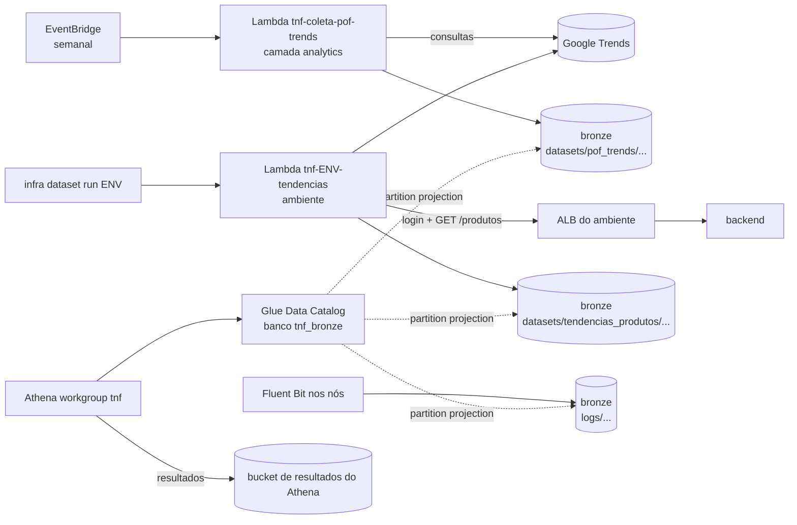

# 10 – Dados analíticos (Lambda, Glue e Athena) e dicionário de dados

Estado: **proposto** (28/10/2026); revisto no mesmo dia contra o documento da disciplina **"Especificação de Base de Dados"** (Análise de Dados, Grupo 03, versão 2.0 de 28/09/2026, daqui em diante **EBD**). Decisões do autor em 28/10/2026: DA2 (a), DA4 (tarefa aceita), DA5 (critério deixado a este spec). DA3 decidida depois da explicação. DA1 aguarda confirmação, porque a resposta (a) conflita com a EBD (seção 9). A EBD foi corrigida na versão 3.0 (seção 12).
Depende de 02 (camadas e bronze), 03 (variáveis), 05 (segredos, B3 e B4), 06 (API do backend atrás do ALB) e 08 (estrutura e `infra`). As etapas que o constroem são a E10 e a E11 de 09.

## 1. Escopo
O spec 01 deixava o datalake "para depois" (01, seção 3): o bronze só recebia os logs do Fluent Bit. Este spec traz para dentro do escopo:
- **Coleta automatizada da base especificada na EBD** ("Consumo e Popularidade de Produtos de Confeitaria em São Paulo", POF/IBGE + Google Trends) por uma Lambda semanal, gravando no bronze o arquivo com o contrato da EBD, seção 2.1.
- **Coleta das tendências dos produtos cadastrados no sistema** por uma segunda Lambda, do ambiente, que lê os produtos pela API do backend (EBD, seção 4.1 e riscos da seção 5).
- **Catálogo no AWS Glue e consultas no Amazon Athena** sobre as duas coletas e sobre os logs que já chegam ao bronze (05, B4), com a discretização e o cruzamento da EBD (seções 3.2 e 3.3) como visões.
- **Dicionário de dados** (Parte B), no formato da EBD, seção 3.1, estendido a todos os campos.

Continuam fora: camadas silver e gold como buckets próprios, jobs de ETL e crawler do Glue (seção 6.1), observabilidade e qualquer mudança no código da aplicação.

## Parte A – Coleta, catálogo e consultas

## 2. Visão geral

- **A base da EBD não depende do sistema** (só da planilha da POF, dos termos fixos e do Google Trends). Por isso a Lambda dela fica na camada persistente `analytics/` e roda **toda semana, com ou sem ambiente no ar**, como a EBD pede ("execução semanal automatizada", seção 2.1).
- **A coleta dos produtos do sistema depende da API**: a Lambda dela pertence ao ambiente (`envs/<env>`, módulo `datasets`), nasce e morre com ele, e roda por `infra dataset run <env>` (agenda opcional).
- **Catálogo, workgroup e bucket de resultados são persistentes** (DA5): camada `analytics/`, ao lado do `bootstrap` (02, seção 2). Os dados continuam consultáveis com os ambientes destruídos, e o `bootstrap`, que guarda o state e o bronze, não é mexido.

## 3. Os scripts e o que muda neles (tarefa fora da infra, DA4)
| Script do `TEM-NA-FESTA-dataset` | Base | Entradas | Saída hoje |
|---|---|---|---|
| `script-tratamento-TNF.py` | **a base da EBD**: 10 categorias da POF/IBGE (aba `Tabela 3.3 Sudeste`, coluna `São Paulo`) com termos fixos no Trends (`geo=BR-SP`, 12 meses) | `bases-externas/*.xls` e `*.csv` | `produtos_confeitaria_popularidade_mensal.csv` (`;`, UTF-8 com BOM, uma coluna por mês) |
| `script-tendencias-produtos-TNF.py` | produtos **ativos** do sistema, com o nome cadastrado como termo do Trends | API (`POST /auth/login`, `GET /produtos`) | `tendencias_produtos_sistema.csv` e log |

**Mudanças necessárias** (DA4, aceita pelo autor; numa branch e com uma **tag** fixada pela infra em `dataset_ref`, seção 7, como o `db_schema_ref` de 05, B5):
1. **Lógica separada da execução:** um módulo com as funções de hoje e dois pontos de entrada em cada script: o `main()` atual (execução local, sem mudança de comportamento) e um `handler(event, context)` para a Lambda.
2. **Regras de validação da EBD, seção 4.2, implementadas** (hoje só a de "coleta externa" existe): estrutural (aba e coluna da POF), identificação (`produto_id` inteiro, único, não nulo), domínio (valores do Trends entre 0 e 100; `consumo_kg_sp` numérico e ≥ 0), integridade (produto, termo e consumo preenchidos; hoje o `consumo_kg_sp` vira vazio em silêncio pelo `errors="coerce"`), temporal (`YYYY-MM`, sem repetição, em ordem), mapeamento e negócio (`fator_sazonalidade = popularidade_pico / popularidade_media`). Uma regra **bloqueante** que falha interrompe a coleta sem gravar nada, e a coleta anterior fica intacta.
3. **Arquivo de rejeições** (EBD, seção 4.1: `id_produto`, produto, motivo, data), gravado mesmo quando a coleta é interrompida.
4. **Saídas no bronze** (seção 5): o **arquivo bruto com o contrato da EBD, seção 2.1** (inclusive `\r\n`, que o pandas só usa no Windows; no Linux da Lambda precisa de `lineterminator="\r\n"`), e as versões **normalizadas** em JSON Lines (formato longo e resumo), que o Glue lê com schema fixo. O CSV largo não serve ao Glue: os nomes das colunas mensais mudam a cada coleta.
5. **Configuração por ambiente e SSM:** o `handler` lê o bucket e a URL da API de variáveis de ambiente e o email e a senha do SSM (seção 8), nunca de `.env`; a planilha e os feriados vão dentro do pacote da Lambda.
6. **Prazo da Lambda (15 min):** as esperas de hoje (20 s entre termos, 60 s e 120 s entre tentativas) cabem com folga em 10 termos sem falhas, mas não no pior caso. O `handler` confere `context.get_remaining_time_in_millis()` e, com menos de 2 min, **interrompe como falha bloqueante de coleta externa** (EBD, seção 4.2), sem gravar a coleta, registrando o motivo nas rejeições.
7. **Log sem segredos** na saída padrão (CloudWatch Logs), sem email, senha nem cookie de sessão.
8. **Correções da EBD 3.0 que tocam o script da base** (seção 12): categoria sem termo no mapa bloqueia a coleta (sai o `fillna` com o próprio `produto_ibge`); `popularidade_media` igual a zero é rejeitada, e o fator passa a usar `replace(0, NA)` em vez de `replace(0, 1)`; `consumo_kg_sp` precisa ser maior que zero; o CSV é gravado com `lineterminator="\r\n"`.

**Risco principal (09, seção 6):** o Google Trends, pela biblioteca não oficial `pytrends`, costuma responder `429` a IPs de nuvem. O primeiro passo da E10 é a prova com a Lambda real (D5). Se falhar de forma persistente, vale o **plano B**: o script roda na máquina do autor e o `infra dataset upload <base> <arquivo>` envia o resultado aos mesmos prefixos; catálogo e visões não mudam.

## 4. As Lambdas
| Item | `tnf-coleta-pof-trends` (base da EBD) | `tnf-<env>-tendencias` (produtos do sistema) |
|---|---|---|
| Camada | `analytics/` (persistente) | `envs/<env>`, módulo `datasets` |
| Gatilho | EventBridge **semanal** (`pof_trends_schedule`, padrão segunda-feira 09:00 de São Paulo) e `infra dataset run pof-trends` | `infra dataset run <env>`; agenda opcional `dataset_schedule` (padrão desligada, porque o ambiente vive poucas horas por sessão, 01 RES-02) |
| Depende de | Google Trends | API do backend pelo DNS do ALB (porta 80, 02 seção 5) e Google Trends |
| Segredos | nenhum | email e senha da coleta, lidos do SSM (seção 8) |

Comum às duas:
- Python 3.12; papel **`LabRole`** (01, RES-03), referenciado por `data "aws_iam_role"`; layer público da AWS **AWS SDK for pandas** (pandas, numpy, pyarrow) e pacote da função com `pytrends`, `requests` e `xlrd`; 1024 MB; 900 s; concorrência reservada 1; **fora da VPC** (sem NAT); variáveis de ambiente **sem segredos**; logs no CloudWatch com retenção de 14 dias.
- **Empacotamento:** `scripts/build-dataset-lambda.sh` (no WSL) baixa o repositório do dataset na tag `dataset_ref`, instala as dependências para Linux e Python 3.12 (`pip install --platform manylinux2014_x86_64 --only-binary=:all: --target`) e gera um zip por Lambda em `.infra/build/`; o Terraform usa `source_code_hash`, então a função só muda quando a tag muda.
- **Carga full e idempotente** (EBD, seção 4.1): cada execução grava a coleta inteira sob a partição `data_coleta` do dia (fuso `America/Sao_Paulo`, como o script). Rodar de novo no mesmo dia **substitui** aquela coleta (gravação em chave temporária e cópia por cima, como o `.tmp` do script); as coletas de outros dias ficam intactas. A "coleta atual" é a de maior `data_coleta` (visões da seção 6.3).
- **Com falha bloqueante**, nada é gravado na partição do dia; só o arquivo de rejeições e o log. É o equivalente, no S3, de "preservar o CSV anterior" da EBD.
- O `infra dataset run` invoca de forma síncrona e imprime o resumo (produtos coletados, rejeições, chave gravada).

## 5. Layout no bronze (complementa 05, B4)
```
datasets/pof_trends/bruto/data_coleta=AAAA-MM-DD/produtos_confeitaria_popularidade_mensal.csv
datasets/pof_trends/resumo/data_coleta=AAAA-MM-DD/resumo.jsonl
datasets/pof_trends/serie/data_coleta=AAAA-MM-DD/serie.jsonl
datasets/pof_trends/rejeicoes/data_coleta=AAAA-MM-DD/rejeicoes.jsonl
datasets/tendencias_produtos/{bruto,resumo,serie,rejeicoes}/env=<env>/data_coleta=AAAA-MM-DD/...
```
- **`bruto`**: exatamente o arquivo do contrato da EBD, seção 2.1 (UTF-8 com BOM, `;`, aspas quando necessárias, `\r\n`, cabeçalho, cinco campos iniciais, meses dinâmicos em ordem cronológica e métricas). É a fonte de verdade da base e o que se entrega à disciplina; não é catalogado no Glue.
- **`resumo`**: uma linha por produto, com os campos fixos do bruto (`produto_id`, `produto_ibge`, `termo_trends`, `consumo_kg_sp`, `data_coleta`, `popularidade_media`, `popularidade_pico`, `mes_pico`, `fator_sazonalidade`, `tipo_feriado_pico`, `evento_associado`). Na base dos produtos do sistema, `produto_nome` e `preco_venda` no lugar de `produto_ibge`, `termo_trends` e `consumo_kg_sp`.
- **`serie`**: uma linha por produto e mês de referência: `produto_id`, `mes_referencia` (`AAAA-MM`), `popularidade` (0 a 100), `mes_parcial` (o mês corrente, ainda incompleto), `data_coleta`. É o "despivotamento" das colunas mensais do bruto.
- **`rejeicoes`**: `produto_id`, `produto`, `regra` (camada da EBD, seção 4.2), `motivo`, `severidade`, `data_ocorrencia`.
- `data_coleta` é a data local de São Paulo; as partições dos logs (B4) continuam em UTC. O conteúdo antigo e os logs do bronze não são tocados (05, B3), e o bronze não ganha expiração.

## 6. Catálogo e consultas (camada `analytics/`)
### 6.1 Glue Data Catalog
- Banco **`tnf_bronze`**, com tabelas **declaradas no Terraform** (`aws_glue_catalog_table`) e **partition projection** (DA5): as partições (`data_coleta`, `env`, `source`, `year`, `month`, `day`) são calculadas pelo Athena a partir do caminho, então uma coleta nova aparece na consulta **sem crawler, sem `MSCK REPAIR` e sem nada rodando à toa**. O schema fica no código, revisado e testado offline (D3).
- Tabelas: `pof_trends_resumo`, `pof_trends_serie`, `pof_trends_rejeicoes`, `tendencias_produtos_resumo`, `tendencias_produtos_serie`, `tendencias_produtos_rejeicoes`, `logs_docker`, `logs_auth` e `logs_systemd` (layout de 05, B4; campos de 02, seção 7.1). As de logs entram porque o layout B4 foi feito para isso e não custam nada parado.
- Por que não crawler: ele precisaria rodar a cada coleta, inferiria tipos diferentes entre coletas e criaria tabelas com nomes derivados das pastas.

### 6.2 Athena
- **Workgroup `tnf`** com local de resultados obrigatório, `enforce_workgroup_configuration = true` e limite de **1 GB escaneado por consulta**.
- **Bucket de resultados** `tnf-athena-<id-da-conta>-<região>`: criado pelo `infra analytics up` com o AWS CLI, como os outros buckets (08, H20), com criptografia, bloqueio de acesso público, só TLS e **expiração de 30 dias**.

### 6.3 Visões (camada de consumo, `analytics/views/*.sql`)
- `vw_pof_trends_atual` e `vw_tendencias_produtos_atual`: a coleta de maior `data_coleta` (por ambiente, na segunda).
- `vw_pof_trends_sazonalidade`: a **discretização da EBD, seção 3.2**: tercis de `fator_sazonalidade` da coleta atual (`approx_percentile` 0,33 e 0,66), rótulos "Baixa sazonalidade", "Sazonalidade moderada" e "Alta sazonalidade"; recalculados a cada coleta, como a EBD prevê (seção 5).
- `vw_pof_trends_consumo_x_estabilidade`: responde à pergunta 3 da EBD (seção 1.2): `consumo_kg_sp` ao lado da faixa de sazonalidade.
- Produtos sem dados suficientes no Trends aparecem como **"Sem dados suficientes"** nas visões da base dos produtos do sistema (EBD, seção 5); na base da EBD, a falta de dados de um termo continua bloqueante (EBD, seção 4.2).

## 7. Variáveis novas (entram em 03 na E10)
| Variável | Camada | Tipo | Padrão | Regra |
|---|---|---|---|---|
| `dataset_repo_url` | `analytics` e `envs` | string | `https://github.com/pedrorico79/TEM-NA-FESTA-dataset` | `https://` |
| `dataset_ref` | `analytics` e `envs` | string | `""` | **sem valor padrão**: obrigatório (tag) quando há Lambda; o `plan` recusa em branco, como 03 seção 3.8 |
| `pof_trends_schedule` | `analytics` | string | `cron(0 12 ? * MON *)` (segunda, 09:00 em São Paulo) | expressão do EventBridge; `null` desliga a agenda |
| `datasets_enabled` | `envs` | bool | `false` | liga o módulo `datasets` no ambiente |
| `dataset_schedule` | `envs` | string | `null` | expressão do EventBridge; `null` não cria a regra |
| `athena_bytes_scanned_cutoff` | `analytics` | number | 1 GB | limite por consulta |

## 8. Segredos (complementa 05, A5) – DA3
- O endpoint `GET /produtos` do backend exige login. A Lambda dos produtos do sistema precisa, então, de um **usuário do sistema** (como os que entram pela tela de login), criado só para ela: perfil comum, sem ser admin, criado à mão uma vez por banco novo, como o primeiro admin (05, B5), e que depois vem nos snapshots.
- O email e a senha desse usuário são **segredos manuais**: entram no `secrets.env` como `dataset_api_email` e `dataset_api_password`, exigidos só com `datasets_enabled = true` (a mesma regra da mensageria, 05 A5), e viram parâmetros SSM `SecureString` em `/tnf/<env>/datasets/`. A Lambda os lê pela `LabRole` na hora de rodar; eles não aparecem nas variáveis da função, no bronze nem nos logs (D10).
- A Lambda da base da EBD não usa segredo nenhum.

## 9. Decisões
| # | Decisão | Situação |
|---|---|---|
| DA1 | Qual coleta a Lambda faz. O autor respondeu (a), "só os produtos do sistema", mas a EBD especifica a base POF/IBGE + Trends com execução semanal automatizada. Proposta revista: **as duas**, com a da EBD semanal na camada `analytics` e a dos produtos do sistema no ambiente | **Aguarda confirmação** (28/10/2026) |
| DA2 | Lambda real chamando o Google Trends, com prova no primeiro passo da E10; plano B: script local + `infra dataset upload` | **Decidido** (28/10/2026) |
| DA3 | Usuário do sistema próprio da coleta; email e senha como segredos manuais no `secrets.env` → SSM | **Decidido** (28/10/2026) |
| DA4 | Mudanças no repositório do dataset (seção 3) como tarefa fora da infra, com tag | **Decidido** (28/10/2026) |
| DA5 | Camada persistente `analytics/` com Glue (tabelas declaradas e partition projection, sem crawler), workgroup, bucket de resultados e tabelas dos logs | **Decidido** (28/10/2026; o autor deixou o critério a este spec) |
| DA6 | Dicionário no formato da EBD, seção 3.1, estendido a todos os campos, em `docs/dicionario-de-dados.md`, conferido por script | *Proposto*; o autor pediu a validação contra a EBD (seção 12) |
| DA7 | Saída no bronze: o arquivo bruto com o contrato da EBD e as versões normalizadas em JSON Lines para o Glue; partição por `data_coleta` (carga full semanal) | *Proposto* (28/10/2026, consequência da EBD, seções 2.1 e 4.1) |

## Parte B – Dicionário de dados

## 10. Dicionário de dados
- **Onde fica** (DA6): `docs/dicionario-de-dados.md` no repositório de infra, fonte única e versionada. A versão entregue à disciplina é gerada a partir dele.
- **Formato:** as mesmas colunas da EBD, seção 3.1: **nome do campo, tipo, tamanho, obrigatório, domínio e regra de validação, exemplo real**, mais **descrição**, **chave** (PK, FK → tabela.coluna) e **sensibilidade**. Os **oito campos com papel** da EBD (`produto_id` chave primária, `data_coleta` data, `evento_associado` categórico fechado, `fator_sazonalidade` numérico a discretizar, `produto_ibge` texto a canonicalizar, `termo_trends` chave de cruzamento, `consumo_kg_sp` e `mes_pico` livres) aparecem com o papel e com exatamente os mesmos tipo, tamanho, domínio e exemplo da EBD; a conferência (D12) recusa divergência.
- **O que cobre:**
  1. **Base da EBD** (bruto e normalizadas, seção 5), com a discretização (EBD 3.2), o cruzamento (3.3), a canonicalização (3.4) e as regras de validação (4.2) referenciadas no campo a que se aplicam.
  2. **Base dos produtos do sistema** (seção 5).
  3. **Banco MySQL `tem_na_festa`**, conforme o script do `TEM-NA-FESTA-database` na tag `db_schema_ref` (05, B5): as 12 tabelas, inclusive `acrescimo` e `desconto_pedido` da migração; domínios de `status_producao`, `tipo_pagamento` e `status_pagamento` lidos dos enums do backend (o banco os guarda como texto livre); diagrama entidade-relacionamento em Mermaid; sensibilidade pela LGPD (nome, telefone, WhatsApp, Instagram, endereço, email; `usuario.senha` é hash e nunca entra em exemplo). É a "base interna" que a EBD, seção 5, prevê cruzar no futuro com o Trends.
  4. **Tabelas do Athena** (seção 6.1), inclusive as de logs.
- **Conferência automática** (`scripts/check-dictionary.sh`, `make dict`, parte do `make check`): compara as colunas do script SQL na tag `db_schema_ref`, as das tabelas do Glue (Terraform) e os oito campos da EBD com o dicionário, e recusa tabela ou coluna faltando, sobrando ou com tipo diferente (D12).

## 11. Critérios de aceite
IDs com a letra **D** (dados). Entram em `tests/TRACEABILITY.md` na E10, quando o `scripts/check-traceability.sh` passa a ler este spec e a letra D (08, seção 7; 09, E10).
| # | Cenário | Esperado |
|---|---|---|
| D1 | `terraform test` do módulo `datasets` e da Lambda da camada `analytics`, com provedor simulado | `LabRole`, Python 3.12, 900 s, concorrência 1, fora da VPC; variáveis de ambiente sem segredo; regra semanal da base da EBD; sem regra no ambiente quando `dataset_schedule = null` |
| D2 | `plan` com Lambda e `dataset_ref` em branco; e com expressão de agenda inválida | recusado com a mensagem em português (03, seção 3.8) |
| D3 | `terraform test` da camada `analytics/` | tabelas com as colunas da seção 5 e a projeção de partições casando com os prefixos de 05 B4 e da seção 5; workgroup com resultados obrigatórios e limite de bytes |
| D4 | `infra analytics up` duas vezes; depois `infra down <env>` | a segunda execução não muda nada; catálogo, workgroup, Lambda da EBD, bucket de resultados e dados do bronze continuam depois do `down` |
| D5 | **Prova do Google Trends** (primeiro passo da E10): `infra dataset run pof-trends` | a Lambda termina dentro do prazo com os 10 termos coletados; se o Trends recusar de forma persistente, registra-se o resultado e passa-se ao plano B (DA2) |
| D6 | Com uma coleta feita, baixar o `bruto` e consultar `pof_trends_resumo` e `pof_trends_serie` no workgroup `tnf` | o `bruto` cumpre o contrato da EBD, seção 2.1 (BOM, `;`, `\r\n`, ordem das colunas); as linhas da coleta aparecem sem crawler nem `MSCK REPAIR` |
| D7 | Rodar a coleta duas vezes no mesmo dia, e de novo em outro dia | a partição do dia é substituída, sem duplicar linhas; a coleta do outro dia fica intacta; a visão "atual" mostra a mais recente |
| D8 | Uma regra bloqueante da EBD, seção 4.2, falhando de propósito (planilha sem a aba, termo sem dados, prazo encurtado por evento de teste) | nada gravado na partição do dia, coleta anterior intacta, linha em `rejeicoes` com regra e motivo |
| D9 | `infra dataset run dev` com o backend fora do ar | erro claro, nenhuma coleta gravada, coleta anterior intacta |
| D10 | Procurar o email e a senha da coleta nas variáveis da função, nos logs da Lambda, nos objetos do bronze e na saída do Terraform | só nos parâmetros SSM |
| D11 | Consultar `logs_docker` filtrando `env`, `source` e um dia | linhas do dia, só das partições pedidas (bytes escaneados pequenos) |
| D12 | `make dict` com uma coluna a mais no script SQL, uma a menos no dicionário, um tipo diferente e um dos oito campos da EBD com domínio diferente | os quatro casos recusados com mensagem que diz o que falta |
| D13 | Revisão do dicionário pelo autor; `vw_pof_trends_sazonalidade` com as três faixas da EBD, seção 3.2 | todas as tabelas e colunas descritas, com domínio, sensibilidade e o diagrama ER; as faixas batem com os tercis calculados à mão sobre o `bruto` |

## 12. Conferência com a EBD (28/10/2026)
O que o planejamento cumpre da EBD: contrato do arquivo (2.1) no `bruto`; carga full e idempotente com reprocessamento que só substitui depois do sucesso (4.1); execução semanal por agendador (2.1 e 4.1); três tentativas e preservação da coleta anterior (4.2 e 5.1); arquivo de rejeições (4.1); discretização por tercis recalculada a cada coleta (3.2 e 5.1); cruzamento por mapa (3.3); dicionário com os oito campos (3.1).

O que a implementação atual (scripts do dataset) ainda não cumpre e entra nas mudanças da seção 3: as regras de validação da 4.2, exceto a de coleta externa; o arquivo de rejeições; a execução semanal automatizada; o `\r\n` fora do Windows.

A versão 2.0 da EBD tinha 14 inconsistências entre as próprias seções e com o script. A pedido do autor, elas foram corrigidas na **versão 3.0** (Claude Doc https://claude.ai/artifact/Gsf78CGjy1QfMYkTbMk6bY), que passa a ser a referência deste spec. Onze eram só de texto: domínio dos valores do Trends (decimais, não inteiros), vírgula decimal nos exemplos, exemplo fora do domínio de `evento_associado`, tercis descritos sobre a variável errada, origem "Feriados Nacionais" não usada, limitações e carga misturando a POF com os produtos do sistema, riscos separados por base, rótulos das faixas e erros de digitação. As três que também mudam o script estão no item 8 da seção 3.

## 13. Pendências
- DA1 (confirmação).
- Descobertas no laboratório, na E10: se a `LabRole` pode ser usada pela Lambda e pelo EventBridge, se o layer público do AWS SDK for pandas está acessível, se o Glue e o Athena aceitam a `LabRole` e **se a agenda semanal dispara com a sessão do laboratório encerrada**; resultado registrado em 02, seção 10. Se não disparar, a coleta semanal passa a ser feita pelo `infra dataset run pof-trends` no início de cada sessão.
- Valores de domínio dos campos de texto livre do banco, lidos dos enums do backend na E11.
- Levar a EBD 3.0 (seção 12) ao documento oficial do grupo.
