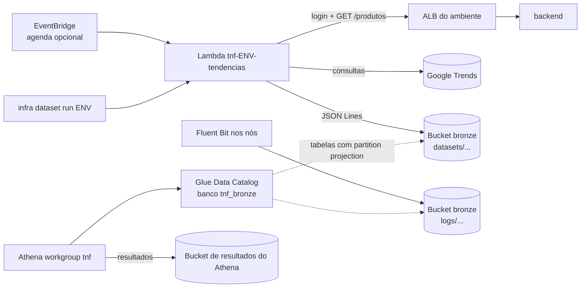

# 10 – Dados analíticos (Lambda, Glue e Athena) e dicionário de dados

Estado: **proposto** (28/10/2026), aguardando as decisões do autor da seção 9 (DA1 a DA6). Até lá, cada ponto marcado *Proposto* segue a opção recomendada.
Depende de 02 (camadas e bronze), 03 (variáveis), 05 (segredos, B3 e B4), 06 (API do backend atrás do ALB) e 08 (estrutura e `infra`). As etapas que o constroem são a E10 e a E11 de 09.

## 1. Escopo
O spec 01 deixava o datalake "para depois" (01, seção 3): o bronze só recebia os logs do Fluent Bit. Este spec traz para dentro do escopo:
- **Coleta do dataset de tendências por uma Lambda**, a partir do script do repositório `TEM-NA-FESTA-dataset` (seção 3), gravando no bronze.
- **Catálogo no AWS Glue e consultas no Amazon Athena** sobre o dataset e, se o autor confirmar (DA5), sobre os logs que já chegam ao bronze no layout de 05, B4.
- **Dicionário de dados** (disciplina de Análise de Dados): o banco MySQL do sistema, o dataset e as tabelas do Athena (Parte B).

Continuam fora: camadas silver e gold como buckets próprios e jobs de ETL do Glue (as visões do Athena da seção 6.3 fazem o papel da camada de consumo), crawler do Glue (seção 6.1), observabilidade e qualquer mudança no código da aplicação.

## Parte A – Coleta, catálogo e consultas

## 2. Visão geral

- A **Lambda pertence ao ambiente** (`envs/<env>`, módulo `datasets`): ela só funciona com o ambiente no ar, porque lê os produtos pela API do backend atrás do ALB do próprio ambiente. Ela nasce e morre com o ambiente, como o ALB.
- **Catálogo, workgroup e bucket de resultados são persistentes** (*Proposto*, DA5): ficam numa camada nova, `analytics/`, ao lado do `bootstrap` (02, seção 2). Assim os dados coletados continuam consultáveis com os ambientes destruídos, e o `bootstrap`, que guarda o state e o bronze, não é mexido.
- O bucket bronze continua sendo o único destino dos dados brutos, com um prefixo novo (`datasets/`) ao lado de `logs/` (seção 5).

## 3. O script e o que muda nele (tarefa fora da infra)
O repositório `TEM-NA-FESTA-dataset` tem dois scripts:
| Script | O que faz | Entradas | Saída hoje |
|---|---|---|---|
| `script-tendencias-produtos-TNF.py` | lê os **produtos ativos** pela API do sistema (`POST /auth/login`, `GET /produtos`) e consulta no Google Trends (`geo=BR-SP`, últimos 12 meses) o nome de cada produto; calcula média, pico, mês de pico, fator de sazonalidade e o evento comercial do mês de pico | `TNF_API_URL`, `TNF_API_EMAIL`, `TNF_API_PASSWORD` (`.env`) | `arquivos-gerados/tendencias_produtos_sistema.csv` (`;`, UTF-8 com BOM, uma coluna por mês) e um log |
| `script-tratamento-TNF.py` | cruza a POF/IBGE (consumo per capita de 10 itens de confeitaria em SP, planilha `.xls`) com o Google Trends de termos fixos e os feriados de 2026 | arquivos de `bases-externas/` | `arquivos-gerados/produtos_confeitaria_popularidade_mensal.csv` |

- **A Lambda roda o script de produtos do sistema** (*Proposto*, DA1). O de POF/IBGE usa dados estáticos (a POF não muda); a parte de consumo (`produto_ibge`, `consumo_kg_sp`) entra **uma vez** no bronze como tabela de referência, enviada pelo `infra dataset seed` (seção 5), sem Lambda.
- **Mudanças necessárias no repositório do dataset** (*Proposto*, DA4; tarefa fora da infra, como as de 00 "Tarefas fora da infra"), numa branch e com uma **tag** que a infra fixa (`dataset_ref`, seção 7), como o `db_schema_ref` (05, B5):
  1. **Separar a lógica da execução local:** um módulo com as funções de hoje e dois pontos de entrada, o `main()` atual (CSV local, sem mudança para quem roda na máquina) e um `handler(event, context)` para a Lambda.
  2. **Configuração por variáveis de ambiente e SSM:** o `handler` lê `TNF_API_URL` do ambiente e o email e a senha do SSM (seção 8), nunca de `.env`.
  3. **Saída em formato longo e estável** (seção 5): o CSV de hoje tem uma coluna por mês (`2026-01`, `2026-02`…), cujo nome muda a cada coleta, o que quebra qualquer schema fixo no Glue. O `handler` grava **JSON Lines** (um objeto por linha, UTF-8 **sem BOM**), com uma linha por produto e mês, e um segundo arquivo com uma linha de resumo por produto (as métricas que o script já calcula).
  4. **Prazo da Lambda:** o script espera 20 s entre produtos e até 60 s e 120 s entre tentativas; a Lambda tem no máximo 15 min. O `handler` consulta `context.get_remaining_time_in_millis()` e **para de começar produtos novos** quando restarem menos de 2 min, grava o que coletou e marca a coleta como incompleta (`coleta_completa = false`), com a lista dos produtos que ficaram de fora.
  5. **Log sem segredos:** o log vai para a saída padrão (CloudWatch Logs da Lambda), sem o email, a senha nem o cookie de sessão.
- **Risco principal (R-DA1, 09 seção 6):** o Google Trends, pela biblioteca não oficial `pytrends`, costuma responder `429` a IPs de nuvem. O primeiro passo da E10 é uma prova com a Lambda real (D5). Se a coleta falhar de forma persistente, vale o **plano B** (DA2 b): o script roda na máquina do autor e o `infra dataset upload <env> <arquivo>` envia o resultado ao mesmo prefixo, no mesmo formato; o resto deste spec não muda.

## 4. A Lambda (módulo `datasets`, em `envs/<env>`)
| Item | Valor |
|---|---|
| Nome | `tnf-<env>-tendencias` |
| Runtime | Python 3.12 (o mesmo do layer abaixo) |
| Papel | **`LabRole`** (01, RES-03: não se criam papéis), referenciada por `data "aws_iam_role"` |
| Dependências | layer público da AWS **AWS SDK for pandas** (pandas, numpy, pyarrow) + pacote da função com `pytrends` e `requests` |
| Memória e prazo | 1024 MB; 900 s |
| Rede | **fora da VPC**: alcança o ALB pelo DNS público (porta 80, 02 seção 5) e o Google Trends pela internet, sem NAT |
| Variáveis de ambiente | `TNF_ENV`, `TNF_API_URL` (`http://<dns do ALB>/api/v1`), `TNF_BUCKET` (bronze), `TNF_SSM_PREFIX` (`/tnf/<env>/datasets/`); **nenhum segredo** |
| Concorrência | reservada em 1 (uma coleta por vez por ambiente) |
| Gatilhos | `infra dataset run <env>` (invocação síncrona, mostra o resumo) e, opcional, regra do EventBridge com `dataset_schedule` (seção 7) |
| Logs | CloudWatch Logs, grupo `/aws/lambda/tnf-<env>-tendencias`, retenção de 14 dias, destruído com o ambiente |

- **Empacotamento:** `scripts/build-dataset-lambda.sh` (na máquina do usuário, dentro do WSL) baixa o repositório do dataset na tag `dataset_ref`, instala `pytrends` e `requests` para Linux e Python 3.12 (`pip install --platform manylinux2014_x86_64 --only-binary=:all: --target`) e gera `.infra/build/dataset-lambda-<ref>.zip`. O `infra up` o chama antes do `apply` quando `datasets_enabled = true`; o zip entra pelo `filename` com `source_code_hash`, então só muda quando a tag muda.
- **Idempotência:** uma coleta por **mês** e ambiente. A chave inclui `ano_mes` da coleta (seção 5); rodar de novo no mesmo mês **substitui** os dois arquivos daquele mês (gravação em chave temporária e cópia por cima, como o `.tmp` do script), sem duplicar linhas.
- **Com o ambiente fora do ar** a Lambda não existe; com ele no ar e o backend fora, ela termina com erro e não grava nada (o mês anterior fica intacto).
- **Agenda:** como os ambientes vivem algumas horas por sessão do laboratório (01, RES-02), uma agenda mensal quase nunca encontraria o ambiente de pé. Por isso o gatilho principal é o `infra dataset run`; a agenda existe para contas fora do laboratório e vem **desligada** por padrão (`dataset_schedule = null`).

## 5. Layout no bronze (complementa 05, B4)
```
datasets/tendencias_produtos/serie/env=<env>/ano_mes=AAAA-MM/serie.jsonl
datasets/tendencias_produtos/resumo/env=<env>/ano_mes=AAAA-MM/resumo.jsonl
datasets/pof_consumo_sp/versao=<AAAA>/pof_consumo_sp.jsonl
```
- `ano_mes` é o mês **da coleta**, no fuso `America/Sao_Paulo` (o mesmo do `data_coleta` do script); as partições dos logs (B4) continuam em UTC.
- **`serie`**: uma linha por produto e mês de referência: `produto_id`, `produto_nome`, `preco_venda`, `mes_referencia` (`AAAA-MM`), `popularidade` (0 a 100, média mensal do Trends), `mes_parcial` (o mês corrente, ainda incompleto), `data_coleta`.
- **`resumo`**: uma linha por produto coletado: `produto_id`, `produto_nome`, `preco_venda`, `popularidade_media`, `popularidade_pico`, `mes_pico`, `fator_sazonalidade`, `evento_associado`, `data_coleta`, `coleta_completa`, `produtos_ignorados` (lista dos que o Trends não devolveu ou que ficaram de fora pelo prazo).
- **`pof_consumo_sp`**: `produto_ibge`, `termo_trends`, `consumo_kg_sp` (kg per capita por ano, POF 2017–2018, SP), enviado uma vez por `infra dataset seed`.
- Formato **JSON Lines** (*Proposto*): é o mesmo dos logs (B4), tem tipos, não sofre com `;` ou vírgula nos nomes dos produtos e é lido pelo Athena com o `JsonSerDe` sem conversão. O CSV largo continua existindo só na execução local do script.
- O conteúdo antigo e os logs do bronze não são tocados (05, B3). O bronze **não ganha expiração** de objetos.

## 6. Catálogo e consultas (camada `analytics/`)
### 6.1 Glue Data Catalog
- Banco **`tnf_bronze`**. Tabelas **declaradas no Terraform** (`aws_glue_catalog_table`) com **partition projection** (*Proposto*, DA5): as partições (`env`, `ano_mes`, `source`, `year`, `month`, `day`) são calculadas pelo Athena a partir do caminho, então uma coleta nova aparece na consulta **sem crawler, sem `MSCK REPAIR` e sem nada rodando à toa**. O schema fica no código, revisado e testado offline (D3).
- Tabelas: `tendencias_serie`, `tendencias_resumo`, `pof_consumo_sp` e, se DA5 incluir, `logs_docker`, `logs_auth` e `logs_systemd` (layout de 05, B4; campos de 02, seção 7.1).
- Por que não crawler: ele precisaria rodar a cada coleta, inferiria tipos diferentes de um mês para outro e criaria tabelas com nomes derivados das pastas; com o schema declarado isso não acontece. (O crawler continua disponível no laboratório se a disciplina pedir para demonstrá-lo; fica fora do caminho principal.)

### 6.2 Athena
- **Workgroup `tnf`** com local de resultados obrigatório no bucket de resultados, `enforce_workgroup_configuration = true` e limite de **1 GB escaneado por consulta**, para nenhuma consulta esquecida consumir crédito.
- **Bucket de resultados** `tnf-athena-<id-da-conta>-<região>`: criado pelo `infra analytics up` com o AWS CLI, como os outros buckets (08, H20), com criptografia, bloqueio de acesso público, só TLS e **expiração de 30 dias** (resultados de consulta são descartáveis).

### 6.3 Visões (camada de consumo)
Visões do Athena, versionadas em `analytics/views/*.sql` e criadas pelo `infra analytics up`:
- `vw_tendencias_ultima_coleta`: a coleta mais recente de cada ambiente.
- `vw_sazonalidade_produtos`: ranking por `fator_sazonalidade`, com o evento associado.
- `vw_tendencias_x_pof` (se DA1 trouxer a POF): os itens da POF ao lado dos produtos do sistema, só por categoria aproximada (os nomes não casam um a um, e a visão diz isso).

## 7. Variáveis novas (entram em 03, seção 3.6, na E10)
| Variável | Tipo | Padrão | Regra |
|---|---|---|---|
| `datasets_enabled` | bool | `false` | liga o módulo `datasets` no ambiente |
| `dataset_repo_url` | string | `https://github.com/pedrorico79/TEM-NA-FESTA-dataset` | `https://` |
| `dataset_ref` | string | `""` | **sem valor padrão**: obrigatório (tag) quando `datasets_enabled = true`; o `plan` recusa em branco, como 03 seção 3.8 |
| `dataset_schedule` | string | `null` | expressão `cron(...)` ou `rate(...)` do EventBridge; `null` não cria a regra |

A camada `analytics/` tem as suas próprias: `region`, `bronze_bucket_name` (mesma convenção de 03), `athena_bytes_scanned_cutoff` (padrão 1 GB) e `include_log_tables` (padrão conforme DA5).

## 8. Segredos (complementa 05, A5)
- A Lambda loga na API com um **usuário do sistema só para a coleta** (*Proposto*, DA3), criado à mão uma vez por banco novo, como o primeiro admin (05, B5), e que vem nos snapshots depois disso. Perfil comum, sem ser admin.
- O email e a senha são **segredos manuais**: entram no `secrets.env` como `dataset_api_email` e `dataset_api_password`, exigidos só com `datasets_enabled = true` (a mesma regra da mensageria, 05 A5), e viram parâmetros SSM `SecureString` em `/tnf/<env>/datasets/`. A Lambda os lê pela `LabRole` em tempo de execução; não estão nas variáveis de ambiente da função, nos objetos do bronze nem nos logs (D10).

## 9. Decisões
| # | Decisão | Situação |
|---|---|---|
| DA1 | A Lambda roda o script de produtos do sistema; a POF entra uma vez como referência estática (`infra dataset seed`) | *Proposto* (aguarda o autor) |
| DA2 | (a) Lambda real chamando o Google Trends, com prova logo no início da E10; (b) plano B: script local + `infra dataset upload` | *Proposto* (a), com (b) como plano B |
| DA3 | Usuário do sistema próprio da coleta; email e senha como segredos manuais no `secrets.env` → SSM | *Proposto* |
| DA4 | Mudanças no repositório do dataset (`handler`, SSM, JSON Lines longo, prazo, tag) como tarefa fora da infra | *Proposto*; falta saber quem as faz |
| DA5 | Camada persistente `analytics/` com Glue (tabelas declaradas e partition projection, sem crawler), workgroup e bucket de resultados; incluir as tabelas dos logs do bronze | *Proposto* |
| DA6 | Dicionário em Markdown no repositório (`docs/dicionario-de-dados.md`), conferido por script, com uma versão exportável para a disciplina; cobre banco, dataset e tabelas do Athena | *Proposto* |

## Parte B – Dicionário de dados

## 10. Dicionário de dados
- **Onde fica** (*Proposto*, DA6): `docs/dicionario-de-dados.md` no repositório de infra, fonte única e versionada; a versão entregue à disciplina (Word ou PDF) é gerada a partir dele.
- **O que cobre:**
  1. **Banco MySQL `tem_na_festa`**, conforme o script do `TEM-NA-FESTA-database` na tag `db_schema_ref` (05, B5): as 12 tabelas (`endereco`, `cliente`, `perfil`, `usuario`, `evento`, `pedido`, `metodo_pagamento`, `pagamento`, `historico_status_pedido`, `produto`, `item_pedido`, `lembrete`), inclusive as colunas da migração `acrescimo` e `desconto_pedido`.
  2. **Dataset de tendências e POF** (seção 5).
  3. **Tabelas do Athena** (seção 6.1), inclusive as de logs se DA5 as incluir.
- **Para cada tabela:** finalidade, origem (sistema, Google Trends, IBGE, Fluent Bit), granularidade (o que é uma linha), chave primária, relacionamentos, volume esperado e quem grava.
- **Para cada coluna:** nome, tipo (MySQL ou Glue/Athena), nulo, chave (PK, FK → tabela.coluna), valor padrão, descrição de negócio, **domínio** (valores válidos; por exemplo os de `status_producao`, `tipo_pagamento` e `status_pagamento`, lidos dos enums do backend, porque o banco os guarda como texto livre), unidade (R$, kg, 0 a 100), exemplo e **classificação de sensibilidade** (dado pessoal pela LGPD: nome, telefone, WhatsApp, Instagram, endereço, email; credencial: `usuario.senha`, que é hash e nunca entra em exemplo).
- **Diagrama entidade-relacionamento** em Mermaid (`erDiagram`) gerado a partir das chaves estrangeiras do script.
- **Regras de qualidade** que o dicionário registra quando valem para a análise: exclusão lógica (`is_deletado`), registros ativos (`is_ativo`), `valor_total` versus soma dos itens e descontos, data de entrega posterior à do pedido.
- **Conferência automática** (`scripts/check-dictionary.sh`, `make dict`, parte do `make check`): compara as tabelas e colunas do script SQL na tag `db_schema_ref` e as das tabelas do Glue (Terraform) com as do dicionário, e recusa tabela ou coluna faltando, sobrando ou com tipo diferente (D12). Assim, quando o schema mudar, o CI acusa o dicionário desatualizado.

## 11. Critérios de aceite
IDs com a letra **D** (dados). Entram em `tests/TRACEABILITY.md` na E10, quando o `scripts/check-traceability.sh` passa a ler este spec e a letra D (08, seção 7; 09, E10).
| # | Cenário | Esperado |
|---|---|---|
| D1 | `terraform test` do módulo `datasets` com provedor simulado | Lambda com a `LabRole`, Python 3.12, 900 s, concorrência 1, fora da VPC; variáveis de ambiente sem nenhum segredo; sem regra do EventBridge quando `dataset_schedule = null` |
| D2 | `plan` com `datasets_enabled = true` e `dataset_ref` em branco; e com `dataset_schedule` inválido | recusado com a mensagem em português (03, seção 3.8) |
| D3 | `terraform test` da camada `analytics/` | tabelas com as colunas da seção 5 e a projeção de partições casando com os prefixos de 05 B4 e da seção 5; workgroup com resultados obrigatórios e limite de bytes |
| D4 | `infra analytics up` duas vezes; depois `infra down <env>` | a segunda execução não muda nada; catálogo, workgroup, bucket de resultados e dados do bronze continuam depois do `down` |
| D5 | **Prova do Google Trends** (primeiro passo da E10): com o dev no ar, `infra dataset run dev` | a Lambda termina dentro do prazo com pelo menos um produto coletado; se o Trends recusar de forma persistente, registra-se o resultado e passa-se ao plano B (DA2) |
| D6 | Com uma coleta feita, consultar `tendencias_serie` e `tendencias_resumo` no workgroup `tnf` | linhas do mês da coleta aparecem sem crawler nem `MSCK REPAIR`; uma linha por produto e mês |
| D7 | `infra dataset run dev` duas vezes no mesmo mês | o mês é substituído, sem linhas duplicadas; os meses anteriores ficam intactos |
| D8 | Coleta com produto sem dados no Trends e com o prazo encurtado de propósito (por evento de teste) | o produto aparece em `produtos_ignorados`; com o prazo curto, `coleta_completa = false` e os produtos já coletados gravados |
| D9 | `infra dataset run dev` com o backend fora do ar | erro claro, nenhum objeto gravado, mês anterior intacto |
| D10 | Procurar o email e a senha da coleta nas variáveis da função, nos logs da Lambda, nos objetos do bronze e na saída do Terraform | só nos parâmetros SSM |
| D11 | Se DA5 incluir os logs: consultar `logs_docker` filtrando `env`, `source` e um dia | linhas do dia, só das partições pedidas (bytes escaneados pequenos) |
| D12 | `make dict` com uma coluna a mais no script SQL, uma a menos no dicionário e um tipo diferente | os três casos recusados com mensagem que diz o que falta |
| D13 | Revisão do dicionário pelo autor (e entrega à disciplina) | todas as tabelas e colunas de banco, dataset e Athena descritas, com domínio, sensibilidade e o diagrama ER |

## 12. Pendências
- As decisões DA1 a DA6 (seção 9).
- Descobertas no laboratório, na E10: se a `LabRole` pode ser usada pela Lambda e pelo EventBridge, se o layer público do AWS SDK for pandas está acessível e se o Glue e o Athena aceitam a `LabRole` sem restrição; resultado registrado em 02, seção 10.
- Valores de domínio dos campos de texto livre (`status_producao`, `tipo_pagamento`, `status_pagamento`), lidos dos enums do backend na E11.
